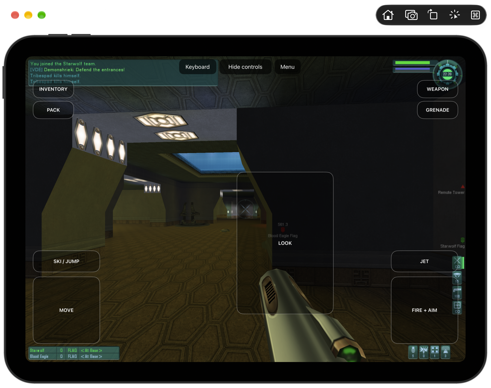

# TribesPad

Tribes 2 on iPad, iPhone and Mac, using the original game and TribesNEXT client.

TribesPad translates the original x86 game ahead of time into native ARM64 code
and supplies the Windows, graphics, audio and network services it expects on Apple
platforms. The aim is the original game, offline bot matches and compatibility with
the existing Tribes 2 community, with touch and controller support on mobile.

**In development.** The Mac app renders and runs offline matches, but performance
is currently too slow for comfortable play. The full iPad Simulator app now loads an offline
Katabatic match with bots and accepts touch movement, aim, weapons, firing and jets.
The Metal backend also renders interiors and supports touch death/respawn.
Slow startup, input delay and a terrain gap shared with Mac still need work.
There is no playable iPad or iPhone release yet.



## What works

- **Original Mac menus and rendering.** The game runs in a signed native Mac app,
  with corrected mouse targeting on Retina displays. [Mac screenshot](docs/validation/macos-retina-katabatic-2026-10-08.png).
- **Offline matches on Mac.** Katabatic loads with two bots. Movement, aiming and
  disc firing have been exercised through native keyboard and mouse input.
- **Internet server listings.** The original browser lists 26 community servers
  and refreshes their information. No online match has been joined in these tests.
- **iPad app integration.** The full original engine builds and starts in the iPad
  Simulator. Its checked GL4ES bridge passes real pixel readback and context
  lifecycle tests, including the original GUI shaders, perspective projection and
  native GPU fences. The [original map on iPad](docs/validation/ipad-katabatic-2026-10-08.png)
  renders, and [touch gameplay](docs/validation/ipad-touch-gameplay-2026-10-08.png)
  moves, aims, switches weapons, fires and jets in the offline match. Touch death
  and [respawn](docs/validation/ipad-angle-respawn-2026-10-09.png) also work.
  The new [Metal backend](docs/validation/ipad-angle-offline.json) passes the native
  clipped-triangle regression and the checked bridge suite with 36 expected guard
  failures. Physical-iPad execution is still unverified.

## iPad controls

Tap **Touch controls** in an offline match to show the overlay.

| Control | Action |
| --- | --- |
| Move pad | Move with the original ESDF bindings |
| Look pad | Drag to aim |
| Fire + Aim | Hold to fire; drag to aim while firing |
| Jet | Hold to jet; release to recover energy |
| Ski / Jump | Original jump action |
| Weapon | Switch weapon |
| Menu | Open the original Escape menu |
| Keyboard | Show the onscreen keyboard for a selected text field |

Movement, look, weapons, fire and jet have been exercised in the Simulator.
Skiing, simultaneous gestures and physical-device responsiveness still need validation.
The bundled app preserves its original warrior and video preferences between launches.

## Current work

- Improve measured runtime performance; builds already cache verified ARM64 objects
  and avoid 179 redundant support-code compilations. Batching checked-memory
  bookkeeping reduces the Simulator executable from 173.2 MB to 158.6 MB; the
  [isolated benchmark](docs/validation/ipad-memory-retirement-components.json)
  improves about 22%. That result is not a gameplay FPS measurement.
- Fix visible rendering gaps and reduce startup/input latency in the iPad app.
- Integrate and refine touch, controller, keyboard and mouse input in real gameplay.
- Verify HD textures, sustained performance and physical-device behavior.

Offline testing and server discovery are the current multiplayer-related checks;
authenticated online play remains unverified. Detailed results and remaining issues
are in [status](docs/STATUS.md) and the [execution plan](docs/EXECUTION-PLAN.md).

## Build from source

The development build needs Xcode, pinned LLVM tools, prepared game inputs and
translated images. A clean checkout is not yet a one-command build.

In the prepared workspace, build and package the Mac app with:

```sh
export DEVELOPER_DIR=/Applications/Xcode.app/Contents/Developer
export SDKROOT="$(xcrun --sdk macosx --show-sdk-path)"
.venv/bin/python scripts/test-qol-native-bootstrap.py \
  generated/srw/run-20261003T190924-ifc22 --probe-ntdll --enter-engine
.venv/bin/python scripts/build-macos-engine-app.py
open generated/integration-review/macos-engine-app/TribesPad.app
```

For the full iPad app, boot one iPad Simulator and use its identifier:

```sh
export SDKROOT="$(xcrun --sdk iphonesimulator --show-sdk-path)"
.venv/bin/python scripts/build-ipad-engine.py --angle --simulator-device <UDID>
```

`--angle` uses a pinned ANGLE Metal renderer behind the existing GL4ES bridge.
Its first build downloads the verified iOS frameworks; subsequent builds reuse
them. Omitting the flag selects the earlier EAGL backend.

Use `--build-only` to preserve a running test session. The development touch overlay
uses the original ESDF bindings and is enabled with **Touch controls**. Its native
event tests pass, and the controls have been exercised in the original offline match.
Tap an original text field, then **Keyboard**, to enter text. The focused field stays
above the onscreen keyboard; Return dismisses it. Sensitivity, simultaneous gestures
and sustained performance still need refinement.

For a self-contained device build:

```sh
export SDKROOT="$(xcrun --sdk iphoneos --show-sdk-path)"
.venv/bin/python scripts/build-ipad-engine.py --platform device --angle --build-only
```

The device app bundles game data and creates a writable profile in Application
Support on first launch. It still needs Apple development signing and physical-iPad
validation; this is not an installable release. Use `--bundle-assets` to exercise
that same storage layout in the Simulator. Default Simulator builds use workspace
assets for faster iteration. The separate Apple controls diagnostic does not contain
the full game.

Builds cache verified translations and optimized ARM64 objects. Changes to the
checked-call policy still run the guard pass; byte-identical guarded output can
reuse its verified native object. The current Metal builds each reused 406 of 409
objects on Simulator and device. Original-engine support compilation reads
symbols directly from checked bitcode, avoiding 179 throwaway native objects before
the final external-call guard and code-generation pass.

Build details, native input helpers and component checks:
**[Development guide](docs/DEVELOPMENT.md)**.

## Game files and references

Game data is not included in this repository. Downloads, textures and generated
translations stay under ignored `ref/` and `generated/` directories.
[Input hashes](inputs-manifest.json) identify the selected game and TribesNEXT files;
[dependency pins](dependencies.lock.json) include the
[HaloPad / ProjectReach](https://github.com/chrissotraidis/projectreach) reference.
Free download availability does not grant redistribution rights.

See the [product target](docs/Tribes2-Online-HD-Target.md) for the intended experience.
Problems: [open an issue](https://github.com/chrissotraidis/tribespad/issues).
