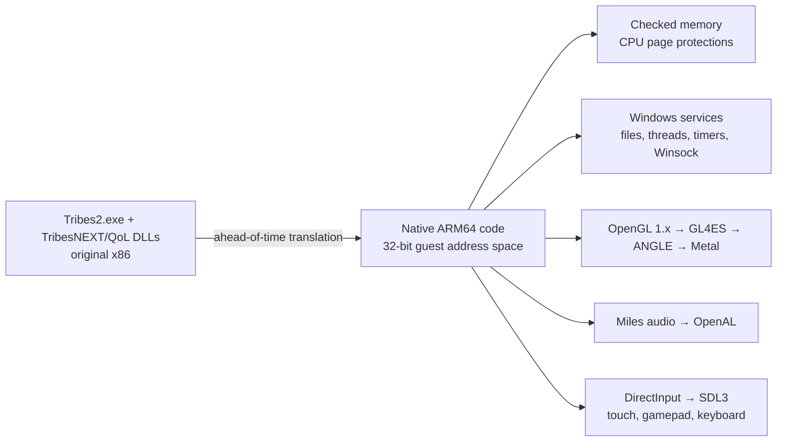

<p align="center">
  
</p>

<h1 align="center">TribesPad</h1>

<p align="center">
  <strong>The original Tribes 2, native on iPad, iPhone and Mac.</strong><br>
  Jetpacks, skiing and capture the flag, translated ahead of time from x86 to native ARM64 and rendered through Metal, with touch controls and gamepad support.
</p>

<p align="center">
  
  
  
  
  
  
  
  
  
  <a href="https://discord.gg/xwHfUD2bxW"></a>
</p>


> [!IMPORTANT]
> **TribesPad is an early release.** One command (or PadMint's **Build** button) downloads
> the free official Tribes 2 and TribesNEXT files and builds your own copy for iPhone,
> iPad and Mac. On a real iPad and iPhone it signs in to TribesNEXT and joins online
> matches with touch or a controller. Expect rough edges: some crashes are still being
> found in online play, and every fix so far came from a session log. See
> [Get TribesPad](#get-tribespad) and [Known issues](#known-issues).

Tribes 2 never had a released Mac version: a Mac port was announced and then put on hold
before the 2001 Windows launch, and only Loki's Linux port shipped. As far as we know,
TribesPad is the first native Tribes 2 for Mac, iPhone and iPad.

## What is TribesPad?

TribesPad runs the **original Tribes 2 executable and the TribesNEXT / QoL client**
on Apple devices. It does not run a CPU emulator and is not a remake: the
game's x86 code is translated ahead of time into native ARM64, and TribesPad supplies
the Windows, OpenGL, audio, input and networking services the game expects. The
original menus, maps, weapons, physics, bots and scripts are all the game's own.

On iPhone and iPad it adds an analog touch layout, gamepad mapping and a small
TribesPad menu for settings. On Mac it runs as a
normal app with mouse and keyboard, on the same Metal renderer.

## Screenshots

| | |
|---|---|
|  |  |
| **Katabatic**, original terrain, fog and snow through Metal | **Base interiors** with the original lighting and HUD |
|  |  |
| **Inventory**: touch controls step aside so the original screen can be tapped | **TribesPad menu**: scores, chat, in-match actions and touch settings during a match |

## Current status

| Question | Answer |
|---|---|
| Is this an emulator or streaming? | Neither. The x86 game and DLLs are translated ahead of time into native ARM64 code. Memory permissions are enforced by the CPU's page protections, and any access that breaks them stops the game. |
| Can I play it today? | **Yes, if you build it.** [One command](#get-tribespad) builds an iPhone/iPad IPA or a Mac app from the official downloads. There is no prebuilt download. |
| Does it work on a real iPad or iPhone? | **Yes, early.** Tested on a 12.9-inch iPad Pro (6th generation) and an iPhone 14 on iOS 27: TribesNEXT sign-in, the internet server list, joining Classic CTF servers and playing with touch and an Xbox controller. |
| What has been played? | Offline Katabatic CTF with two bots: spawning, movement, aiming, firing, jets, skiing/jumping, weapon switching, grenades, inventory, an end-of-match map change, and a clean quit. A 30-minute session ran without a crash. |
| Does it match the original game? | In the one scenario measured so far, yes: a [reference trace](docs/validation/reference-trace-katabatic.json) of the same Katabatic flight is bit-identical to the original Windows game in the air and differs by about 1 cm after landing, where the QoL collision patch applies (the Windows reference ran without QoL). |
| Online play? | **Yes.** TribesPad opens to the TribesNEXT login, remembers your password if you ask it to, and joins community servers. Most servers are empty outside North American evenings; see [Online servers](#online-servers). |
| Controllers? | One Xbox, PlayStation or MFi extended gamepad maps to the original bindings, played on iPad with an Xbox controller. |
| Is the game included? | **No.** Your build downloads the free official Tribes 2 installer and the TribesNEXT client and checks them by SHA-256. See [Game data](#game-data). |

### Performance

Performance went from unplayable to steady in the Simulator:

| Build | Offline Katabatic, iPad Air 11-inch (M4) Simulator |
|---|---|
| Software-checked memory (start) | 6–7 FPS, 221 s map load |
| Page-protection memory checks | ~20 FPS |
| + lighter GL checks, draw streaming, texture-upload ring, faster float paths | **~30 FPS** steady, worst frames 50–90 ms, ~70 s map load |

The steady 30 FPS is the vertical-sync pacing: with VSync off the same match runs
36–37 FPS. Details are in the [handoff](docs/HANDOFF.md) and
[performance records](docs/validation/ipad-hardware-permissions.json).

On a physical 12.9-inch iPad Pro (M2), online with maximum detail settings, menus run
at 74–104 FPS and matches at about 22–31 FPS. To go faster, try **··· → Graphics →
Balanced** (or **Fast**) and **Settings → Render Scale** below 100%. The
[performance notes](docs/PERFORMANCE.md) explain the measurements and how to read the
FPS counter and session log.

## Play an offline match

1. Choose **LAN GAME → HOST → Katabatic**, enable two bots and tap **START GAME**.
2. When the world appears, the touch controls appear by themselves.
3. Tap **Fire** to spawn.


### Touch controls

| Control | Action |
|---|---|
| **Move stick** (bottom left) | Analog movement |
| **Right side of the screen** | Drag anywhere that is not a button to aim |
| **Fire** (bottom right) | Hold to fire; drag to aim while firing |
| **Jet** (orange) · **Ski / Jump** · **Grenade** · **Weapon** | Beside and above Fire |
| **Pack · Inventory** | Above the move stick; Inventory hides the controls so the original screen can be tapped |
| **Controller / X button** (right edge) | Show or hide the touch controls |
| **Cursor button** (right edge) | Turn the trackpad cursor on or off |
| **Keyboard button** (right edge) | Onscreen keyboard for chat and text fields |
| **··· menu** (right edge) | Game Menu (Escape), Scores, Chat, in-match actions, settings, help |

### Menus on iPhone

The original menus were made for a mouse, and on a phone their buttons are smaller
than a fingertip. With the **trackpad cursor** (on by default on iPhone), the whole
screen works like a laptop trackpad while the touch controls are hidden: drag to
move the cursor, tap anywhere to click, touch and hold then drag to hold the
button (sliders, scroll bars), and drag with two fingers to scroll. Turn it off
with the cursor button to tap the menus directly. On iPhone the game stays clear
of the notch and rounded corners, with TribesPad's buttons in the side margin;
turn off **Settings → Keep Clear of the Notch** to fill the whole screen.

In Inventory, tap the original **Done**, then the controller button to resume. To
close the game, use **Launch → Quit** in the original menu.

### TribesPad menu

The ··· menu is the same in both games, in this order. Each game item sends the
game's own key, so the original screens open.

| Section | What it has |
|---|---|
| This Match (on a server) | **Game Menu** (the original Escape menu), **Scores**, **Chat** (all, team, quick chat), **Actions** (repair kit, mine or beacon, targeting laser, flag, zoom, third-person view, command map, suicide) |
| Play Online | **Who's Playing Now**: every server with people (and, in Tribes 2, bots counted separately; the game's own list mixes them: "40/48 (38)" is two people); tap one to join. **Server List**: the original PLAY GAME → JOIN (on a server it offers to leave the match first). **Game Nights**: the regular pickup times, in your device's time zone. **Community**: the game's Discords and sites. Open at the top between matches; a submenu during one. |
| Options | Show / Hide Touch Controls, Trackpad Cursor, FPS Counter (top right: frames each second and the slowest frame), Graphics Quality (Tribes 2: **Balanced** or **Fast**, and **Render Scale** on iPad), Settings… (touch size, opacity, look sensitivity, left-handed, hide with a controller, trackpad speed, notch, FPS counter, render scale) |
| Help | Touch and trackpad guide, controller guide, original console, TribesPad on GitHub, About |
| Choose Game… | Closes TribesPad (iOS doesn't let an app restart itself); the next time you open it, the game picker appears |


### Controller layout

While playing:

| Control | Action | Control | Action |
|---|---|---|---|
| Left stick | Move | Right stick | Aim (fine near center, fast at full tilt) |
| RT | Fire | LT | Jet |
| A | Ski / jump | B | Place mine |
| X | Use pack | Y | Grenade |
| RB / LB | Next / previous weapon | Click right / left stick | Zoom on / off / third person |
| D-pad up / down | Repair kit / inventory | D-pad left / right | Beacon / quick chat |
| Menu | Game menu | View | Scores |

The first few times you play with a controller, a short card shows this layout; the
full guide is in **··· → Help → Controller Guide**.

In menus, lobbies and screens the left stick or D-pad moves the cursor, A clicks
(hold to drag), B or Menu goes back, and the right stick scrolls. The game does
not see the controller while a menu is open. Look speed is in Settings.

Disconnecting releases the controller's actions, and backgrounding the app releases all controls.

### Online servers

On iPhone and iPad, TribesPad opens to the TribesNEXT login. Tap **Account** or
**Password** and the keyboard opens with the login pane above it. Sign in with
your TribesNEXT account (**CREATE NEW ACCOUNT** makes a free one), then
**PLAY GAME → JOIN** lists the internet servers. Tick **Remember Password** to skip
typing it next time. You join as an observer: press **Fire** (RT on a controller) to
join a team. Change armor and weapons at an inventory station or with **Inventory**
(D-pad down).

The Tribes 2 community mostly plays at set times in North American evenings: pickup
games, The Cut and the 25th Anniversary draft league. At other hours most public
servers are empty or hold only bots. **··· → Play Online** shows who is playing now,
the regular game nights in your time zone, and the PlayT2 and The Cut Discords, where
pickups are organized.
Missing maps and interiors download from the TribesNEXT asset depot (on by default
in TribesPad).

### Game picker

TribesPad opens to a picker: **Starsiege: Tribes** and **Tribes 2**, each with how many people
are playing now. Tap a card, or choose with the D-pad, left stick or arrow keys and press A or
Return. The gear at the top right has **Open Tribes 2 Directly**, which skips the picker;
**Settings → Display → Game Picker at Launch** brings it back. In a game, **··· → Choose Game…**
closes TribesPad, and the picker appears the next time you open it (iOS doesn't let an app restart
itself). Each card shows its game's own title screen, taken at build time from your own downloads.
Nothing from either game is in the repository.

### Starsiege: Tribes

Starsiege: Tribes 1.41, the version the community plays online, runs natively on ARM64 on iPhone,
iPad and Mac, recompiled the same way as Tribes 2. Build it in with
`scripts/build-tribespad.sh --games tribes2,starsiege`, which downloads PlayT1's installer and checks
it against `config/starsiege/inputs.json`.

- **Offline:** TRAINING with bots, or HOST MULTIPLAYER.
- **Online:** JOIN lists the community master servers (tribes1.co); **··· → Play Online** shows
  who is playing, PlayT1's nightly pickup in your time zone, and the PlayT1 Discord.
- **Controller:** RT fire, LT jet, A jump, RB/LB next/previous weapon, Y grenade, X pack, B crouch;
  the D-pad has repair kit, inventory, beacon and quick chat. In menus, X double-clicks to buy.
- **IRC Chat** in the game's menu does nothing: it connects to Dynamix's IRC server, which closed
  long ago. Tribes 1 players talk in the PlayT1 Discord (**··· → Play Online → Community**).
- **Not yet:** modded servers (RPG and other mods) need their own files, which the game cannot
  download; graphics presets ([validation](docs/validation/starsiege-g2.md)).


### Keyboard and trackpad

With a Magic Keyboard or keyboard folio on iPad, **W A S D** move, **E** zooms and **Q** picks
the next weapon, as with Tribes 2's WASD layout. TribesPad translates keys from the physical
keyboard into the game's own E S D F binds, so the touch controls and controllers keep working
and your saved binds don't change. Turn it off in **Settings → Keyboard and Trackpad** to use
the original keys. The trackpad moves the game's cursor in menus; in play the game asks iPadOS
to lock the pointer for mouse look (full screen only). Keyboards without an Esc key can use
⌘-period, or map Caps Lock to Escape in iPadOS Settings → General → Keyboard → Hardware Keyboard.


### Skins

In the Files app, **On My iPad (or iPhone) → TribesPad → Skins** takes Tribes 2 player
skins (`name.lmale.png`, `name.lfemale.png`, `name.lbioderm.png`) and skin packs
(`.vl2`). TribesPad copies them into the game when it opens; choose yours under
**PLAY GAME → WARRIOR SETUP → Custom Skins**. Other players see your skin only if they
have the same file. TribesPad ships no community skins.

**Settings → Online Play** off starts offline instead: Training, LAN Game, and
the internet server list in JOIN without signing in.

## Recompiled, not decompiled

TribesPad contains no Tribes 2 source code, original or reconstructed. It works
from the game's shipped Windows machine code:

1. **Input.** The original x86 binaries: `Tribes2.exe`, the TribesNEXT/QoL client
   DLL and the Miles audio DLL and codec plugins.
2. **Lift.** Each x86 code block is converted into compiler intermediate code
   (LLVM IR), one function per original block, keeping the game's exact 32-bit
   memory layout.
3. **Compile.** That code is compiled ahead of time to native ARM64 and linked
   with the TribesPad runtime. Nothing is interpreted or just-in-time compiled
   while you play.

Around the translated game, TribesPad supplies what Windows and the PC used to:
the Windows API functions the game calls (files, threads, timers, memory,
sockets), OpenGL through GL4ES and ANGLE to Metal, exact x87 floating point,
DirectInput through SDL3, and Miles audio through OpenAL. The QoL client patches
the engine's code while it runs; each of those patches was captured and
translated in advance, so code written at run time is never executed.

This differs from decompilation ports, which rebuild readable C source and
then modify it. TribesPad keeps the original program's behavior instruction for
instruction, which keeps it faithful to the original and compatible with TribesNEXT
servers.

## How it works



- **Memory checks the CPU enforces.** The game's 32-bit address space keeps exact 4 KiB
  Windows page permissions. Pages are protected in hardware, mixed pages are checked in a
  fault handler, and any violation stops the game.
- **Original rendering.** The game's fixed-function OpenGL runs through GL4ES and ANGLE
  on Metal, with streaming paths added for draws and texture uploads.

## Get TribesPad

TribesPad never ships the game. You build your own copy: the build downloads the free
official Tribes 2 and TribesNEXT files and turns them into an app on your Mac. It needs a
Mac with Apple Silicon, about 40 minutes the first time and 40 GB of free space.

### Mac

1. Install **Xcode** from the App Store and open it once.
2. Install [Homebrew](https://brew.sh), then run:
   ```sh
   brew install llvm@20 cmake ninja sevenzip zstd
   ```
3. Build:
   - **With [PadMint](https://github.com/chrissotraidis/padmint) (0.5.13 or newer):** choose TribesPad and press **Build**.
   - **Or in Terminal:**
     ```sh
     git clone https://github.com/chrissotraidis/tribespad.git
     cd tribespad
     scripts/build-tribespad.sh --platform macos
     ```
4. Unzip `build/output/TribesPad-mac.zip`, drag **TribesPad** to Applications and open it.

No Apple account is needed for the Mac.

### iPhone and iPad (experimental)

1. Do steps 1–2 above, then build with PadMint, or in the `tribespad` folder in Terminal:
   ```sh
   scripts/build-tribespad.sh
   ```
   No Mac? Build it on GitHub's free Mac from Windows, Linux or any computer with a web
   browser: follow [PadMint's steps](https://github.com/chrissotraidis/padmint#no-mac-build-on-githubs-mac).
   The IPA contains the game, so keep it to yourself.
2. Install `build/output/TribesPad.ipa` with [Sideloadly](https://sideloadly.io) or
   your usual signing tool.

> [!NOTE]
> TribesPad runs without Apple's *Extended Virtual Addressing* permission. It was tested
> with a paid Apple Developer account; a free Apple ID should work (apps then expire after
> seven days) but has not been tried. The app is about 1 GB with the game data.

### First launch

Accept the license, create a warrior, then choose **LAN GAME → HOST → START GAME** for a
match against bots. On iPhone and iPad, tap the controller button to show touch controls.

## Game data

No Tribes 2 or TribesNEXT files are stored in this repository or published by it. The
build keeps the downloads in the ignored `ref/` folder and its own work in `generated/`.
The accepted files are listed by SHA-256 in [inputs-manifest.json](inputs-manifest.json)
and [config/game-inputs.json](config/game-inputs.json). That a game is free to
download does not grant the right to redistribute it.

To recreate the exact translated code the engine was tested with, the build lifts your
downloaded binaries with the pinned recompiler and then applies small binary differences
from [patches/translation](patches/translation) (about 3.5 MB, recorded in
[config/translation-patches.json](config/translation-patches.json)). Each result is
checked by SHA-256. The patches are useless without your own lift of the official files.
How this works, stage by stage, is in [Reproducible build](docs/REPRODUCIBLE-BUILD.md).

## Known issues

- **Crashes in online play.** Each crash so far was a Windows or OpenGL function the
  translated game had not reached before. TribesPad now keeps a session log in its
  app data (`Library/Logs/TribesPad.log`, previous session beside it); attach it to an
  issue. Every OpenGL 1.1 function the game loads is now either implemented or a logged
  no-op, so that family of crashes should be over.
- **Performance.** Online matches can lag on busy maps, and loading datablocks takes a
  while. High ping is usually distance: most servers are in North America.
- **Hosting.** HOST works for a local game with bots. Registering a hosted server on the
  internet list is new and lightly tested.
- **Not implemented:** clipboard paste with a hardware keyboard, joining by host name
  (the IP dialog), and deleting recorded demos stop the game.
- **Night maps are dark**, as in the original.

## Roadmap

- Fix crashes reported in session logs; measure frame rate and heat on iPad
- A server browser that sorts by human players, using the TribesNEXT server list
- Automatic map downloads for community map packs
- Touch layout editor
- Measure Mac performance
- Compare with the QoL client on Windows and add jet, weapon and bot scenarios to the reference trace
- Join TribesNEXT community servers
- Starsiege: mod packs, IRC chat, graphics presets and faster loading
  ([plan](docs/STARSIEGE-TRIBES-PLAN.md), [validation](docs/validation/starsiege-g2.md))
- A headless dedicated server on a Mac, then Linux on ARM
  ([plan](docs/DEDICATED-SERVER-PLAN.md))
- Raspberry Pi 5 / Linux on ARM, then Android, as personal builds
  ([plan](docs/ANDROID-LINUX-PLAN.md))

## Documentation

- [Handoff](docs/HANDOFF.md): what works, current evidence and next steps
- [Development guide](docs/DEVELOPMENT.md): building, packaging and validation
- [Reproducible build](docs/REPRODUCIBLE-BUILD.md): how the one-command build recreates the game from the official downloads
- [Validation records](docs/validation): measurements and screenshots
- [Product target](docs/Tribes2-Online-HD-Target.md): the intended experience
- [Starsiege: Tribes plan](docs/STARSIEGE-TRIBES-PLAN.md): evidence, a lift preview and gated steps for a second game
- [Launcher plan](docs/LAUNCHER-PLAN.md): the game picker, Switch Game, per-game controls and folders, and when it ships
- [Android and Linux plan](docs/ANDROID-LINUX-PLAN.md): what carries over from the Apple build, and gated steps for Raspberry Pi and Android
- [Dedicated server plan](docs/DEDICATED-SERVER-PLAN.md): how Tribes 2 servers run today and a headless TribesPad server
- [Community research](docs/COMMUNITY-RESEARCH.md): what players asked for, community data sources and ranked feature ideas
- [Archive](docs/archive): historical status checkpoints, plans and rejected experiments

## Credits

Tribes 2 was developed by Dynamix and published by Sierra. Thanks to the
[TribesNEXT](https://www.tribesnext.com) community, which keeps the game and its
servers alive. Touch control design follows HaloPad /
[ProjectReach](https://github.com/chrissotraidis/projectreach) and SunPad.

TribesPad's own code is released under the [MIT License](LICENSE). Tribes 2, TribesNEXT
and their files belong to their owners and are not covered by it; this repository
contains none of them. The translation patches in `patches/translation` apply only to
your own lift of the official downloads.

TribesPad is an unofficial fan project and is not affiliated with or endorsed by
the owners of Tribes 2. Report problems in [issues](https://github.com/chrissotraidis/tribespad/issues).
