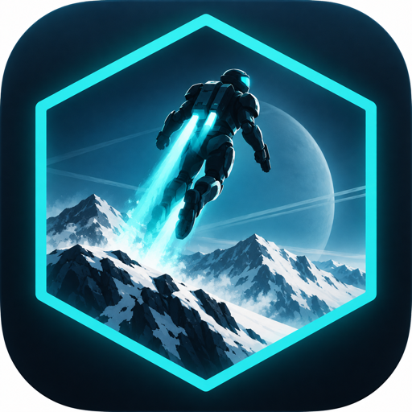
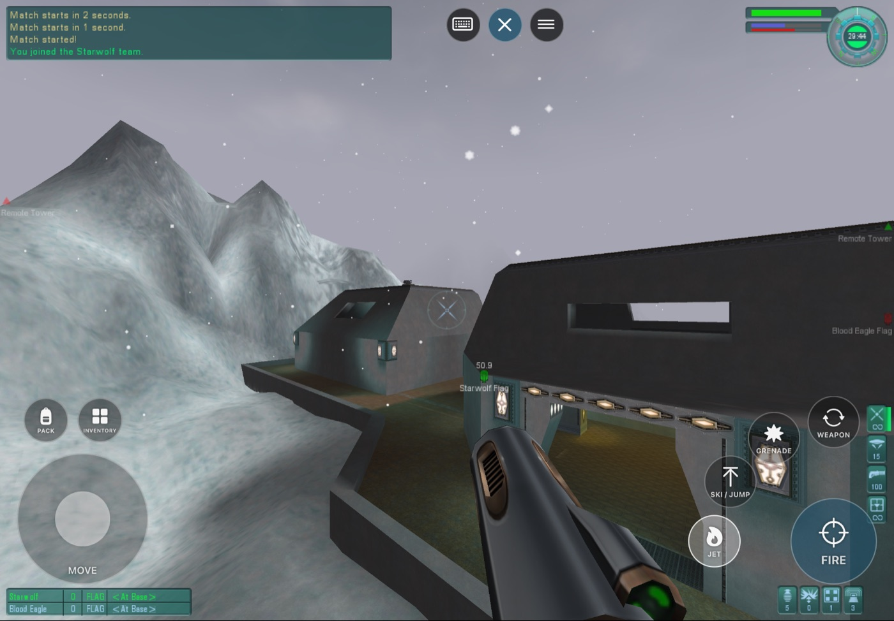
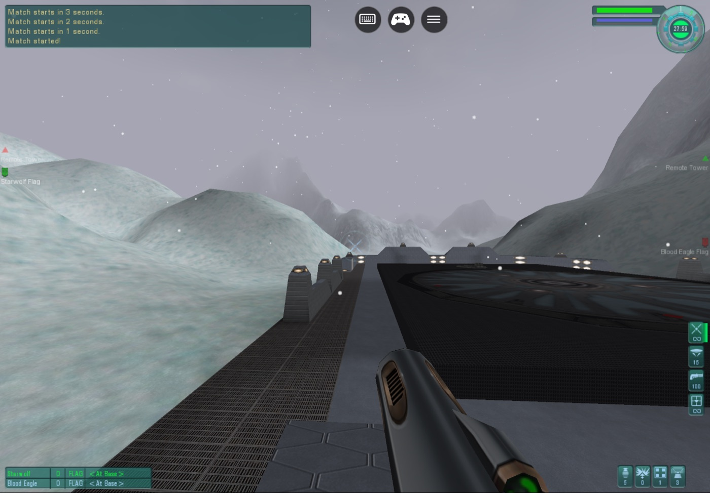
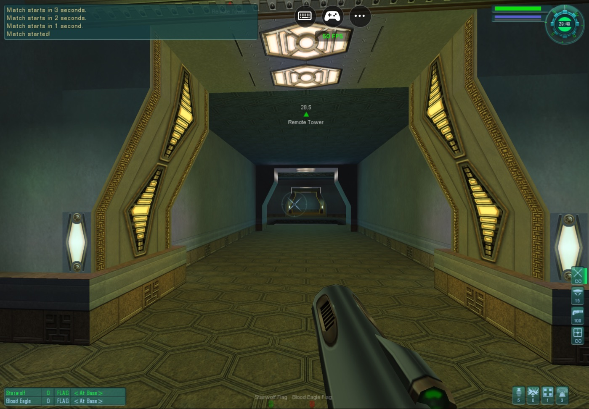
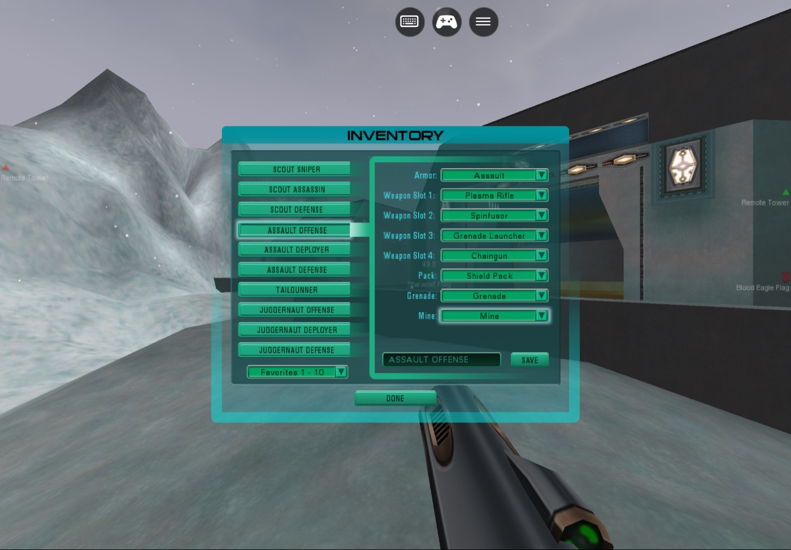
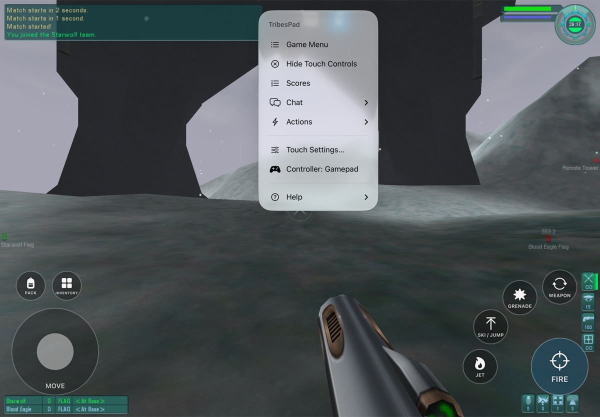
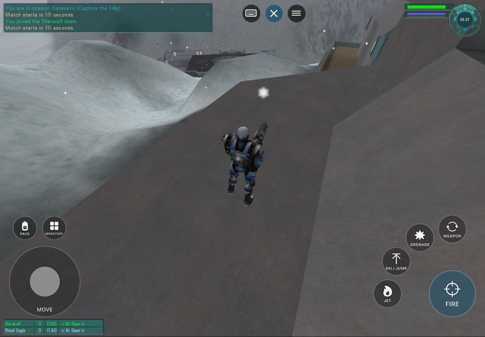
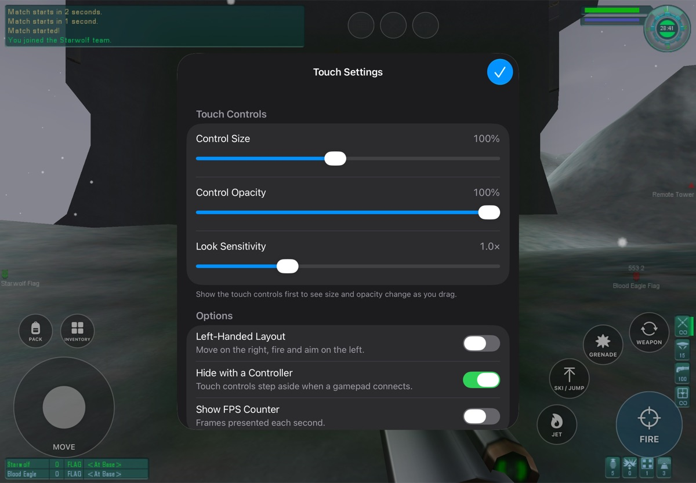
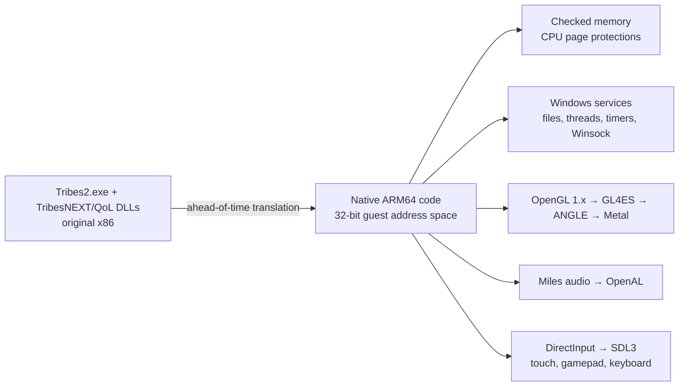

<p align="center">
  
</p>

<h1 align="center">TribesPad</h1>

<p align="center">
  <strong>The original Tribes 2, native on iPad, iPhone and Mac.</strong><br>
  Jetpacks, skiing and capture the flag, translated ahead of time from x86 to native ARM64 and rendered through Metal, with touch controls and gamepad support.
</p>

<p align="center">
  
  
  
  
  
  
  
  
  
</p>



> [!IMPORTANT]
> **TribesPad is in development.** One command (or PadMint's **Build** button) downloads
> the free official Tribes 2 and TribesNEXT files and builds your own copy for iPhone,
> iPad and Mac. Offline matches against bots play in the iPad Simulator and on Mac.
> Physical iPad, iPhone and controller play have not been verified, and online joining
> is not yet tested. See [Get TribesPad](#get-tribespad).

## What is TribesPad?

TribesPad runs the **original Tribes 2 executable and the TribesNEXT / QoL client**
on Apple devices. It does not run a CPU emulator and is not a remake: the
game's x86 code is translated ahead of time into native ARM64, and TribesPad supplies
the Windows, OpenGL, audio, input and networking services the game expects. The
original menus, maps, weapons, physics, bots and scripts are all the game's own.

On iPhone and iPad it adds an analog touch layout, gamepad mapping and a small
TribesPad menu for settings. On Mac it runs as a
normal app with mouse and keyboard, on the same Metal renderer.

## Screenshots

| | |
|---|---|
|  |  |
| **Katabatic**, original terrain, fog and snow through Metal | **Base interiors** with the original lighting and HUD |
|  |  |
| **Inventory**: touch controls step aside so the original screen can be tapped | **TribesPad menu**: scores, chat, in-match actions and touch settings during a match |

## Current status

| Question | Answer |
|---|---|
| Is this an emulator or streaming? | Neither. The x86 game and DLLs are translated ahead of time into native ARM64 code. Memory permissions are enforced by the CPU's page protections, and any access that breaks them stops the game. |
| Can I play it today? | **You can build it and play offline.** [One command](#get-tribespad) builds an iPhone/iPad IPA or a Mac app from the official downloads. Offline matches with bots play by touch in the iPad Simulator at about 30 FPS and with mouse and keyboard on Mac. |
| Does it work on a real iPad or iPhone? | **Not verified on hardware.** The IPA builds for iPhone and iPad and passes PadMint's package check. In the iPhone 17 Simulator an offline match plays by touch, with the game kept clear of the Dynamic Island and every menu fully on screen. |
| What has been played? | Offline Katabatic CTF with two bots: spawning, movement, aiming, firing, jets, skiing/jumping, weapon switching, grenades, inventory, an end-of-match map change, and a clean quit. A 30-minute session ran without a crash. |
| Does it match the original game? | In the one scenario measured so far, yes: a [reference trace](docs/validation/reference-trace-katabatic.json) of the same Katabatic flight is bit-identical to the original Windows game in the air and differs by about 1 cm after landing, where the QoL collision patch applies (the Windows reference ran without QoL). |
| Online play? | The original server browser lists TribesNEXT community servers on Mac. Joining online matches and account sign-in have not been tested. |
| Controllers? | One Xbox, PlayStation or MFi extended gamepad maps to the original bindings. Native input tests pass; play with a physical controller is unverified. |
| Is the game included? | **No.** Your build downloads the free official Tribes 2 installer and the TribesNEXT client and checks them by SHA-256. See [Game data](#game-data). |

### Performance

Performance went from unplayable to steady in the Simulator:

| Build | Offline Katabatic, iPad Air 11-inch (M4) Simulator |
|---|---|
| Software-checked memory (start) | 6–7 FPS, 221 s map load |
| Page-protection memory checks | ~20 FPS |
| + lighter GL checks, draw streaming, texture-upload ring, faster float paths | **~30 FPS** steady, worst frames 50–90 ms, ~70 s map load |

The steady 30 FPS is the vertical-sync pacing: with VSync off the same match runs
36–37 FPS. Physical-device numbers will differ. Details are in the
[handoff](docs/HANDOFF.md) and [performance records](docs/validation/ipad-hardware-permissions.json).

## Play an offline match

1. Choose **LAN GAME → HOST → Katabatic**, enable two bots and tap **START GAME**.
2. When the world appears, tap the **controller button** on the right edge to show the touch controls.
3. Tap **Fire** to spawn.



### Touch controls

| Control | Action |
|---|---|
| **Move stick** (bottom left) | Analog movement |
| **Right side of the screen** | Drag anywhere that is not a button to aim |
| **Fire** (bottom right) | Hold to fire; drag to aim while firing |
| **Jet · Ski / Jump · Grenade · Weapon** | The ring around Fire |
| **Pack · Inventory** | Above the move stick; Inventory hides the controls so the original screen can be tapped |
| **Controller / X button** (right edge) | Show or hide the touch controls |
| **Cursor button** (right edge) | Turn the trackpad cursor on or off |
| **Keyboard button** (right edge) | Onscreen keyboard for chat and text fields |
| **··· menu** (right edge) | Game Menu (Escape), Scores, Chat, in-match actions, settings, help |

### Menus on iPhone

The original menus were made for a mouse, and on a phone their buttons are smaller
than a fingertip. With the **trackpad cursor** (on by default on iPhone), the whole
screen works like a laptop trackpad while the touch controls are hidden: drag to
move the cursor, tap anywhere to click, touch and hold then drag to hold the
button (sliders, scroll bars), and drag with two fingers to scroll. Turn it off
with the cursor button to tap the menus directly. On iPhone the game fills the
whole screen; **Settings → Keep Clear of the Notch** shrinks it instead.

In Inventory, tap the original **Done**, then the controller button to resume. To
close the game, use **Launch → Quit** in the original menu.

### TribesPad menu

The menu reaches the original game's keyboard-only features by touch. Each item
sends the game's own key, so the original screens open.

| Item | What it does |
|---|---|
| Game Menu | The original Escape menu |
| Scores | The original score screen (F2); choose it again to close |
| Chat | All Chat, Team Chat (the keyboard opens and the controls return after sending) and the Quick Chat menu |
| Actions | Repair kit, mine, beacon, targeting laser, throw flag, zoom, third-person view, command map, suicide |
| Show / Hide Touch Controls, Trackpad Cursor | Same as the buttons on the right edge |
| Settings… | Touch controls (size, opacity, look sensitivity, left-handed, hide with a controller), trackpad cursor and speed, keep clear of the notch, FPS counter; reset to defaults |
| Help | Touch and trackpad guide, controller guide, original console, TribesPad on GitHub, About |



### Controller layout

| Control | Action | Control | Action |
|---|---|---|---|
| Left stick | Move | Right stick | Aim |
| RT | Fire | LT | Jet |
| A | Ski / jump | X | Use pack |
| LB | Grenade | RB | Next weapon |
| Y | Inventory | Menu | Escape |

Disconnecting releases the controller's actions, and backgrounding the app releases all controls.

## Recompiled, not decompiled

TribesPad contains no Tribes 2 source code, original or reconstructed. It works
from the game's shipped Windows machine code:

1. **Input.** The original x86 binaries: `Tribes2.exe`, the TribesNEXT/QoL client
   DLL and the Miles audio DLL and codec plugins.
2. **Lift.** Each x86 code block is converted into compiler intermediate code
   (LLVM IR), one function per original block, keeping the game's exact 32-bit
   memory layout.
3. **Compile.** That code is compiled ahead of time to native ARM64 and linked
   with the TribesPad runtime. Nothing is interpreted or just-in-time compiled
   while you play.

Around the translated game, TribesPad supplies what Windows and the PC used to:
the Windows API functions the game calls (files, threads, timers, memory,
sockets), OpenGL through GL4ES and ANGLE to Metal, exact x87 floating point,
DirectInput through SDL3, and Miles audio through OpenAL. The QoL client patches
the engine's code while it runs; each of those patches was captured and
translated in advance, so code written at run time is never executed.

This differs from decompilation ports, which rebuild readable C source and
then modify it. TribesPad keeps the original program's behavior instruction for
instruction, which keeps it faithful to the original and is what should keep it
compatible with TribesNEXT servers (joining a server is not yet tested).

## How it works



- **Memory checks the CPU enforces.** The game's 32-bit address space keeps exact 4 KiB
  Windows page permissions. Pages are protected in hardware, mixed pages are checked in a
  fault handler, and any violation stops the game.
- **Original rendering.** The game's fixed-function OpenGL runs through GL4ES and ANGLE
  on Metal, with streaming paths added for draws and texture uploads.

## Get TribesPad

TribesPad never ships the game. You build your own copy: the build downloads the free
official Tribes 2 and TribesNEXT files and turns them into an app on your Mac. It needs a
Mac with Apple Silicon, about 40 minutes the first time and 15 GB of free space.

### Mac

1. Install **Xcode** from the App Store and open it once.
2. Install [Homebrew](https://brew.sh), then run:
   ```sh
   brew install llvm@20 cmake ninja sevenzip zstd
   ```
3. Build:
   - **With [PadMint](https://github.com/chrissotraidis/padmint):** choose TribesPad and press **Build**.
   - **Or in Terminal:**
     ```sh
     git clone https://github.com/chrissotraidis/tribespad.git
     cd tribespad
     scripts/build-tribespad.sh --platform macos
     ```
4. Unzip `build/output/TribesPad-mac.zip`, drag **TribesPad** to Applications and open it.

No Apple account is needed for the Mac.

### iPhone and iPad (experimental)

1. Do steps 1–2 above, then build with PadMint, or in the `tribespad` folder in Terminal:
   ```sh
   scripts/build-tribespad.sh
   ```
   No Mac? Fork this repository, open **Actions → Build TribesPad for iPhone and iPad →
   Run workflow**, and download the IPA from the finished run.
2. Install `build/output/TribesPad.ipa` with [Sideloadly](https://sideloadly.io),
   signed with an Apple ID in the **paid Apple Developer Program**.

> [!NOTE]
> TribesPad needs Apple's *Extended Virtual Addressing* permission. Free Apple IDs most
> likely cannot grant it, so plan on a paid developer account. TribesPad has not yet been
> installed on a real iPhone or iPad; the GitHub build has not been run yet either.

### First launch

Accept the license, create a warrior, then choose **LAN GAME → HOST → START GAME** for a
match against bots. On iPhone and iPad, tap the controller button to show touch controls.

## Game data

No Tribes 2 or TribesNEXT files are stored in this repository or published by it. The
build keeps the downloads in the ignored `ref/` folder and its own work in `generated/`.
The accepted files are listed by SHA-256 in [inputs-manifest.json](inputs-manifest.json)
and [config/game-inputs.json](config/game-inputs.json). That a game is free to
download does not grant the right to redistribute it.

To recreate the exact translated code the engine was tested with, the build lifts your
downloaded binaries with the pinned recompiler and then applies small binary differences
from [patches/translation](patches/translation) (about 3.5 MB, recorded in
[config/translation-patches.json](config/translation-patches.json)). Each result is
checked by SHA-256. The patches are useless without your own lift of the official files.
How this works, stage by stage, is in [Reproducible build](docs/REPRODUCIBLE-BUILD.md).

## Roadmap

- Install and play on a physical iPad; decide the VSync default on hardware
- Play with a physical controller
- Run the GitHub build workflow and PadMint's player check once the repository is public
- Touch layout editor
- Measure Mac performance
- Compare with the QoL client on Windows and add jet, weapon and bot scenarios to the reference trace
- Join TribesNEXT community servers

## Documentation

- [Handoff](docs/HANDOFF.md): what works, current evidence and next steps
- [Development guide](docs/DEVELOPMENT.md): building, packaging and validation
- [Reproducible build](docs/REPRODUCIBLE-BUILD.md): how the one-command build recreates the game from the official downloads
- [Validation records](docs/validation): measurements and screenshots
- [Product target](docs/Tribes2-Online-HD-Target.md): the intended experience
- [Archive](docs/archive): historical status checkpoints, plans and rejected experiments

## Credits

Tribes 2 was developed by Dynamix and published by Sierra. Thanks to the
[TribesNEXT](https://www.tribesnext.com) community, which keeps the game and its
servers alive. Touch control design follows HaloPad /
[ProjectReach](https://github.com/chrissotraidis/projectreach) and SunPad.

The project does not yet have a license; until one is added, all rights are reserved.

TribesPad is an unofficial fan project and is not affiliated with or endorsed by
the owners of Tribes 2. Report problems in [issues](https://github.com/chrissotraidis/tribespad/issues).
