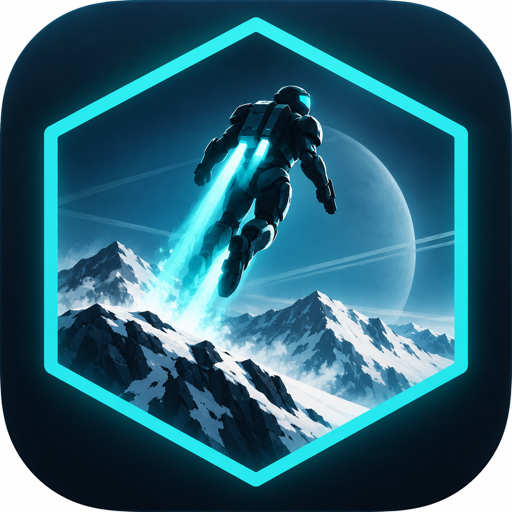
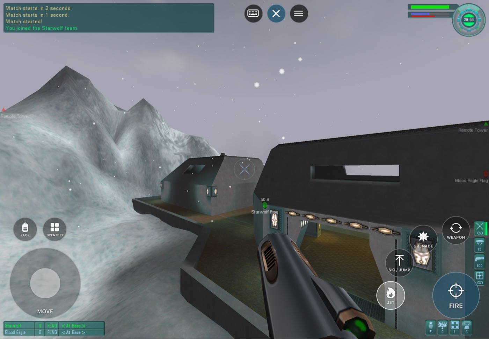
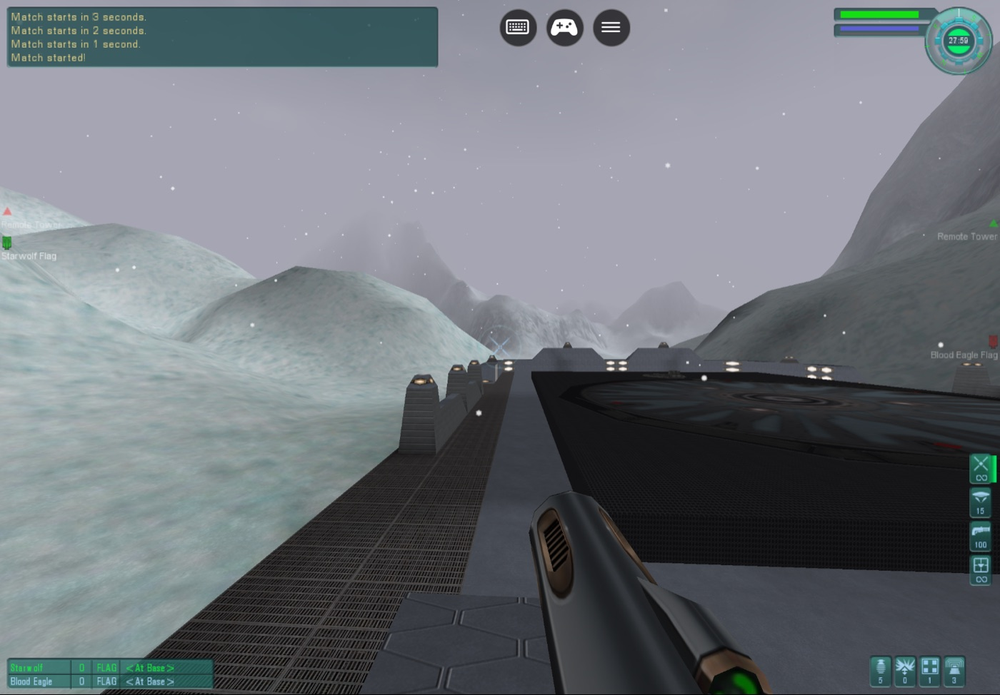
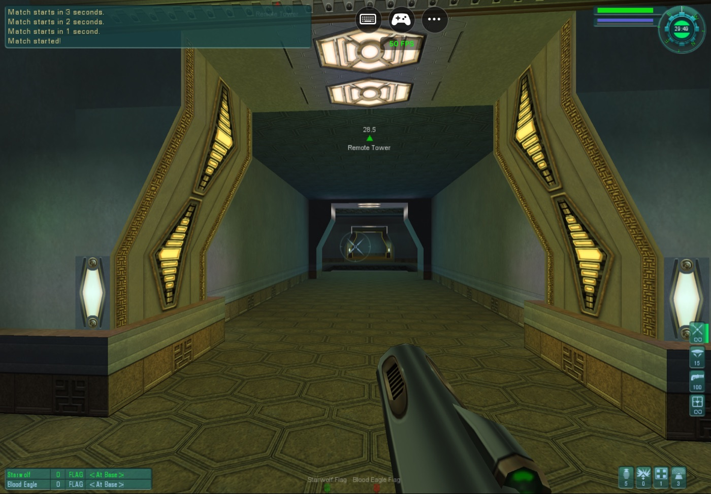
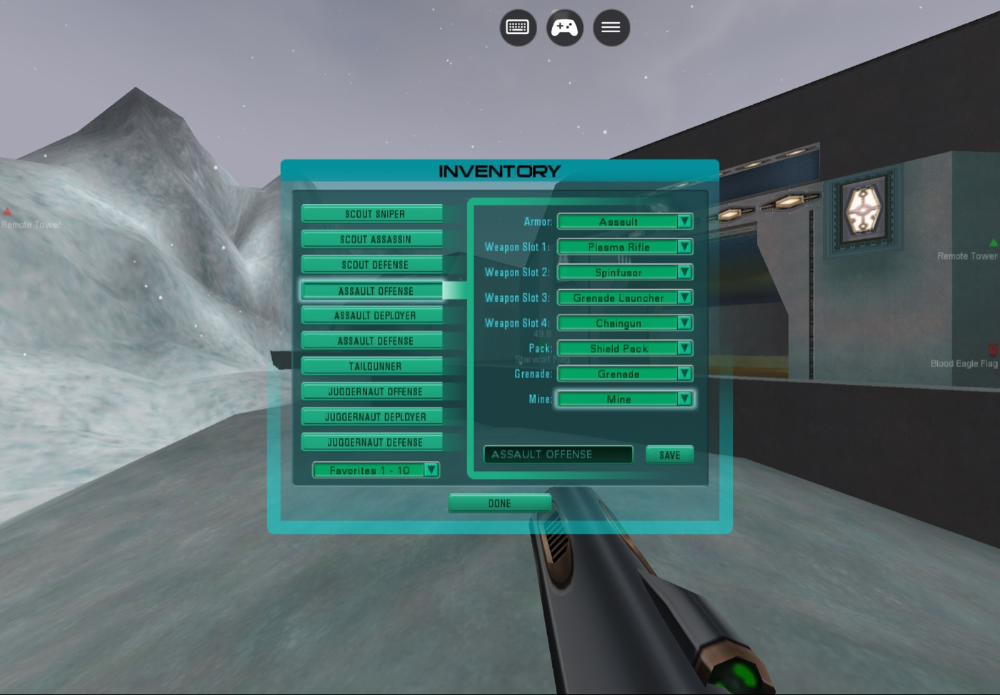
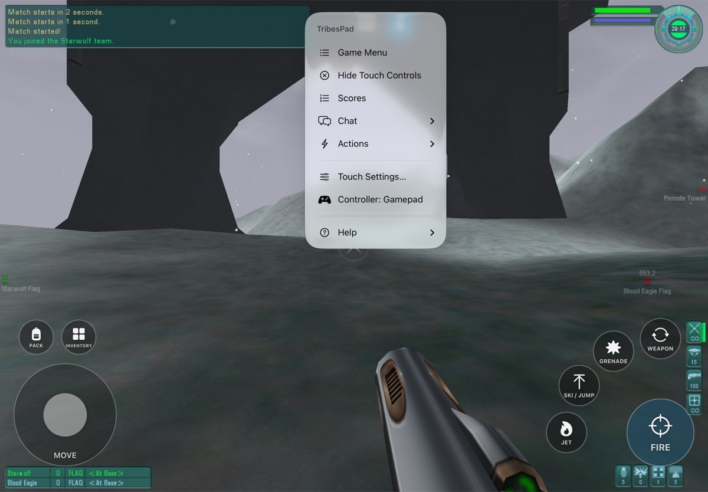
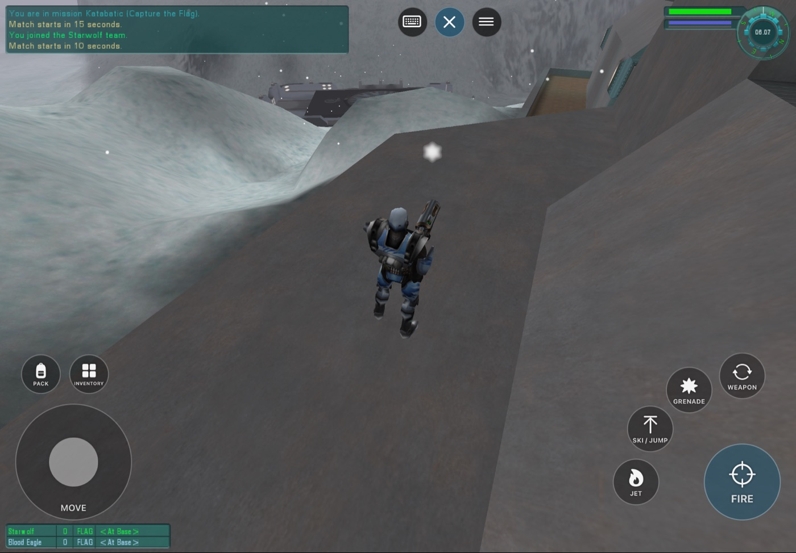
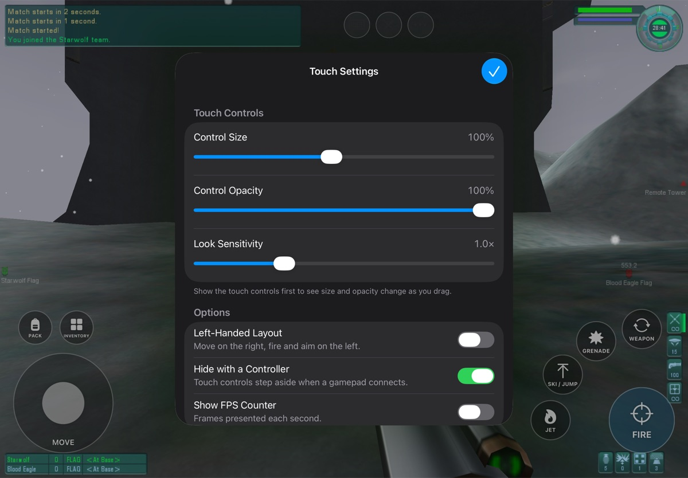
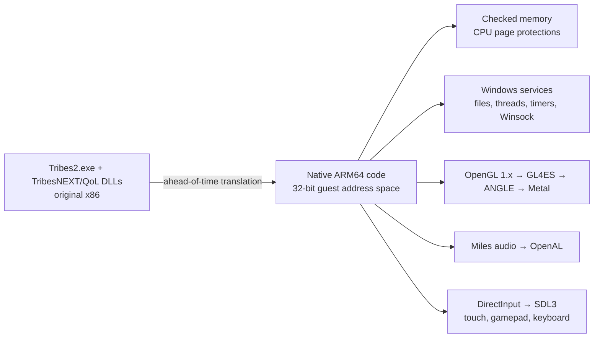

<p align="center">
  
</p>

<h1 align="center">TribesPad</h1>

<p align="center">
  <strong>The original Starsiege: Tribes, Tribes 2 and Tribes: Vengeance, native on iPad, iPhone and Mac.</strong><br>
  Jetpacks, skiing and capture the flag, translated ahead of time from x86 to native ARM64 and rendered through Metal, with touch controls and gamepad support.
</p>

<p align="center">
  
  
  
  
  
  
  
  
  
  <a href="https://discord.gg/xwHfUD2bxW"></a>
</p>



> [!IMPORTANT]
> **TribesPad is an early release.** One command downloads the free official Tribes 2 and
> TribesNEXT files, the community's Starsiege: Tribes 1.41 installer and the community's free
> Revengeance release of Tribes: Vengeance, and builds your own copy for iPhone, iPad and Mac.
> Pick any of the three games when it opens. (PadMint's **Build** button builds Tribes 2 and
> Starsiege for now.) On a real iPad and iPhone it signs in to TribesNEXT and joins online
> matches with touch or a controller. Expect rough edges: some crashes are still being
> found in online play, and every fix so far came from a session log. See
> [Get TribesPad](#get-tribespad) and [Known issues](#known-issues).

Tribes 2 never had a released Mac version: a Mac port was announced and then put on hold
before the 2001 Windows launch, and only Loki's Linux port shipped. As far as we know,
TribesPad is the first native Tribes 2 for Mac, iPhone and iPad.

## What is TribesPad?

TribesPad runs the **original Tribes 2 executable and the TribesNEXT / QoL client**
on Apple devices. It does not run a CPU emulator and is not a remake: the
game's x86 code is translated ahead of time into native ARM64, and TribesPad supplies
the Windows, OpenGL, audio, input and networking services the game expects. The
original menus, maps, weapons, physics, bots and scripts are all the game's own.

It also runs **Starsiege: Tribes** (1998), version 1.41, the one the community plays
online, translated the same way, and **Tribes: Vengeance** (2004), Irrational Games' Unreal
Engine 2 sequel: the whole campaign, online play on the community's OpenSpy servers, and bot
matches on the community's TRIBESai maps. TribesPad opens to a picker with all three games
and how many people are playing each right now.

On iPhone and iPad it adds an analog touch layout, gamepad mapping and a small
TribesPad menu for settings. On Mac it runs as a
normal app with mouse and keyboard, on the same Metal renderer.

## Screenshots

| | |
|---|---|
|  |  |
| **Katabatic**, original terrain, fog and snow through Metal | **Base interiors** with the original lighting and HUD |
|  |  |
| **Inventory**: touch controls step aside so the original screen can be tapped | **TribesPad menu**: scores, chat, in-match actions and touch settings during a match |

## Current status

| Question | Answer |
|---|---|
| Is this an emulator or streaming? | Neither. The x86 game and DLLs are translated ahead of time into native ARM64 code. Memory permissions are enforced by the CPU's page protections, and any access that breaks them stops the game. |
| Can I play it today? | **Yes, if you build it.** [One command](#get-tribespad) builds an iPhone/iPad IPA or a Mac app from the official downloads. There is no prebuilt download. |
| Does it work on a real iPad or iPhone? | **Yes, early.** Tested on a 12.9-inch iPad Pro (6th generation) and an iPhone 14 on iOS 27: TribesNEXT sign-in, the internet server list, joining Classic CTF servers and playing with touch and an Xbox controller. |
| What has been played? | Offline Katabatic CTF with two bots: spawning, movement, aiming, firing, jets, skiing/jumping, weapon switching, grenades, inventory, an end-of-match map change, and a clean quit. A 30-minute session ran without a crash. |
| Does it match the original game? | In the one scenario measured so far, yes: a [reference trace](docs/validation/reference-trace-katabatic.json) of the same Katabatic flight is bit-identical to the original Windows game in the air and differs by about 1 cm after landing, where the QoL collision patch applies (the Windows reference ran without QoL). |
| Online play? | **Yes.** TribesPad opens to the TribesNEXT login, remembers your password if you ask it to, and joins community servers. Most servers are empty outside North American evenings; see [Online servers](#online-servers). |
| Controllers? | One Xbox, PlayStation or MFi extended gamepad maps to the original bindings, played on iPad with an Xbox controller. |
| Starsiege: Tribes? | **Yes.** Version 1.41 from the game picker: bot matches offline and community servers online, with the same touch, controller and ··· menu as Tribes 2. Played on iPad; Mac and the iPhone Simulator reach the menus and matches. See [Starsiege: Tribes](#starsiege-tribes). |
| Tribes: Vengeance? | **Yes.** The campaign, online play through OpenSpy, and bot matches on four TRIBESai maps with Easy, Normal and Hard bots, with touch, a controller and the ··· menu. Played on a 12.9-inch iPad Pro with an Xbox controller; the Mac app runs it too. On iPhone and iPad it is an optional 3.1 GB download inside the app. See [Tribes: Vengeance](#tribes-vengeance). |
| Is the game included? | **No.** Your build downloads the free official Tribes 2 installer, the TribesNEXT client, the Starsiege: Tribes installer and the Revengeance release, and checks them by SHA-256. See [Game data](#game-data). |

### Performance

Performance went from unplayable to steady in the Simulator:

| Build | Offline Katabatic, iPad Air 11-inch (M4) Simulator |
|---|---|
| Software-checked memory (start) | 6–7 FPS, 221 s map load |
| Page-protection memory checks | ~20 FPS |
| + lighter GL checks, draw streaming, texture-upload ring, faster float paths | **~30 FPS** steady, worst frames 50–90 ms, ~70 s map load |

The steady 30 FPS is the vertical-sync pacing: with VSync off the same match runs
36–37 FPS. Details are in the [handoff](docs/HANDOFF.md) and
[performance records](docs/validation/ipad-hardware-permissions.json).

On a physical 12.9-inch iPad Pro (M2), online with maximum detail settings, menus run
at 74–104 FPS and matches at about 22–31 FPS. To go faster, try **··· → Graphics →
Balanced** (or **Fast**) and **Settings → Render Scale** below 100%. The
[performance notes](docs/PERFORMANCE.md) explain the measurements and how to read the
FPS counter and session log.

## Play an offline match

1. Choose **LAN GAME → HOST → Katabatic**, enable two bots and tap **START GAME**.
2. When the world appears, the touch controls appear by themselves.
3. Tap **Fire** to spawn.



### Touch controls

| Control | Action |
|---|---|
| **Move stick** (bottom left) | Analog movement |
| **Right side of the screen** | Drag anywhere that is not a button to aim |
| **Fire** (bottom right) | Hold to fire; drag to aim while firing |
| **Jet** (orange) · **Ski / Jump** · **Grenade** · **Weapon** | Beside and above Fire |
| **Pack · Inventory** | Above the move stick; Inventory hides the controls so the original screen can be tapped |
| **Controller / X button** (right edge) | Show or hide the touch controls |
| **Cursor button** (right edge) | Turn the trackpad cursor on or off |
| **Keyboard button** (right edge) | Onscreen keyboard for chat and text fields |
| **··· menu** (right edge) | Game Menu (Escape), Scores, Chat, in-match actions, settings, help |

### Menus on iPhone

The original menus were made for a mouse, and on a phone their buttons are smaller
than a fingertip. With the **trackpad cursor** (on by default on iPhone), the whole
screen works like a laptop trackpad while the touch controls are hidden: drag to
move the cursor, tap anywhere to click, touch and hold then drag to hold the
button (sliders, scroll bars), and drag with two fingers to scroll. Turn it off
with the cursor button to tap the menus directly. On iPhone the game stays clear
of the notch and rounded corners, with TribesPad's buttons in the side margin;
turn off **Settings → Keep Clear of the Notch** to fill the whole screen.

In Inventory, tap the original **Done**, then the controller button to resume. To
close the game, use **Launch → Quit** in the original menu.

### TribesPad menu

The ··· menu is the same in both games, in this order. Each game item sends the
game's own key, so the original screens open.

| Section | What it has |
|---|---|
| This Match (on a server) | **Game Menu** (the original Escape menu), **Scores**, **Chat** (all, team, quick chat), **Actions** (repair kit, mine or beacon, targeting laser, flag, zoom, third-person view, command map, suicide) |
| Play Online | **Who's Playing Now**: every server with people (and, in Tribes 2, bots counted separately; the game's own list mixes them: "40/48 (38)" is two people); tap one to join. **Server List**: the original PLAY GAME → JOIN (on a server it offers to leave the match first). **Game Nights**: the regular pickup times, in your device's time zone. **Community**: the game's Discords and sites. Open at the top between matches; a submenu during one. |
| Options | Show / Hide Touch Controls, Trackpad Cursor, FPS Counter (top right: frames each second and the slowest frame), Graphics Quality (Tribes 2: **Balanced** or **Fast**, and **Render Scale** on iPad), **Bots** (Vengeance: difficulty and game size for the bot maps you host), Settings… (touch size, opacity, look sensitivity, left-handed, hide with a controller, trackpad speed, notch, FPS counter, render scale) |
| Help | Touch and trackpad guide, controller guide, original console, TribesPad on GitHub, About |
| Choose Game… | Closes TribesPad (iOS doesn't let an app restart itself); the next time you open it, the game picker appears |

On the Mac the same items are in the menu bar (**Game**, **Play Online**, **Help**). Vengeance's
Quick Save and Quick Load are ⌘S and ⌘L, and **Choose Game…** (⌘G) returns to the picker.

### Bots

Each game adds bots where it already would:

| Game | Where |
|---|---|
| Tribes 2 | **HOST** screen: turn on Bots, choose how many and their difficulty range, then start (its own bots, on any map) |
| Starsiege: Tribes | In a game you host, **Tab → Options → Bots…**: Add 2 Bots, Add 4 Bots, Remove All Bots, Easy, Normal or Hard Bots |
| Tribes: Vengeance | **MULTIPLAYER → HOST**: choose Capture the Flag and one of the four TRIBESai bot maps; its bots switch on by themselves a few seconds after you are in. Difficulty and size: **··· → Options → Bots** (the Mac: **Game → Bots**) |



### Controller layout

While playing:

| Control | Action | Control | Action |
|---|---|---|---|
| Left stick | Move | Right stick | Aim (fine near center, fast at full tilt) |
| RT | Fire | LT | Jet |
| A | Ski / jump | B | Place mine |
| X | Use pack | Y | Grenade |
| RB / LB | Next / previous weapon | Click right / left stick | Zoom on / off / third person |
| D-pad up / down | Repair kit / inventory | D-pad left / right | Beacon / quick chat |
| Menu | Game menu | View | Scores |

The first few times you play with a controller, a short card shows this layout; the
full guide is in **··· → Help → Controller Guide**.

In menus, lobbies and screens the left stick or D-pad moves the cursor, A clicks
(hold to drag), B or Menu goes back, and the right stick scrolls. The game does
not see the controller while a menu is open. Look speed is in Settings.

Disconnecting releases the controller's actions, and backgrounding the app releases all controls.

### Online servers

On iPhone and iPad, TribesPad opens to the TribesNEXT login. Tap **Account** or
**Password** and the keyboard opens with the login pane above it. Sign in with
your TribesNEXT account (**CREATE NEW ACCOUNT** makes a free one), then
**PLAY GAME → JOIN** lists the internet servers. Tick **Remember Password** to skip
typing it next time. You join as an observer: press **Fire** (RT on a controller) to
join a team. Change armor and weapons at an inventory station or with **Inventory**
(D-pad down).

The Tribes 2 community mostly plays at set times in North American evenings: pickup
games, The Cut and the 25th Anniversary draft league. At other hours most public
servers are empty or hold only bots. **··· → Play Online** shows who is playing now,
the regular game nights in your time zone, and the PlayT2 and The Cut Discords, where
pickups are organized.
Missing maps and interiors download from the TribesNEXT asset depot (on by default
in TribesPad).

### Game picker

TribesPad opens to a picker: **Starsiege: Tribes**, **Tribes 2** and **Tribes: Vengeance**, each
with how many people are playing now. Vengeance is an optional download: its card says
**DOWNLOAD** until you install it (below). Tap a card, or choose with the D-pad, left stick or arrow keys and press A or
Return. The gear at the top right has **Open Tribes 2 Directly**, which skips the picker;
**Settings → Display → Game Picker at Launch** brings it back. In a game, **··· → Choose Game…**
closes TribesPad, and the picker appears the next time you open it (iOS doesn't let an app restart
itself). Each card shows its game's own title screen, taken at build time from your own downloads.
Nothing from either game is in the repository.

### Starsiege: Tribes

Starsiege: Tribes 1.41, the version the community plays online, runs natively on ARM64 on iPhone,
iPad and Mac, recompiled the same way as Tribes 2. Every build includes it: the build downloads
PlayT1's installer and checks it against `config/starsiege/inputs.json` (`--games tribes2` leaves
it out).

- **Offline:** TRAINING or HOST MULTIPLAYER. In a game you host, **Tab → Options → Bots…** adds
  the game's own AI drones, two or four at a time, on both teams, and sets their difficulty (the
  AI's own skill: IQ 40, 70 or 100). They run between the bases and fight; the original AI never
  carries flags, and drones are not listed on the scoreboard.
- **Online:** JOIN lists the community master servers (tribes1.co); **··· → Play Online** shows
  who is playing, PlayT1's nightly pickup in your time zone, and the PlayT1 Discord.
- **Controller:** RT fire, LT jet, A jump, RB/LB next/previous weapon, Y grenade, X pack, B crouch;
  the D-pad has repair kit, inventory, beacon and quick chat. In menus, X double-clicks to buy.
- **IRC Chat** in the game's menu does nothing: it connects to Dynamix's IRC server, which closed
  long ago. Tribes 1 players talk in the PlayT1 Discord (**··· → Play Online → Community**).
- **Not yet:** modded servers (RPG and other mods) need their own files, which the game cannot
  download; graphics presets ([validation](docs/validation/starsiege-g2.md)).

### Tribes: Vengeance

Tribes: Vengeance runs natively on iPhone, iPad and Mac, recompiled from the community's free
Revengeance release the same way as the other two games. Nothing from the game is in the
repository, and on iPhone and iPad it is an **optional download**: tap its card, then
**Download**. TribesPad fetches the same release from tribesrevengeance.net (3.1 GB), unpacks it
on the device and checks every file against `config/vengeance/inputs.json`. It needs about
15 GB free while it installs and keeps 11 GB (the campaign and its 200 multiplayer maps); keep
TribesPad open meanwhile, and a paused download continues where it left off. The gear on the
picker has **Remove Tribes: Vengeance** to free the space. The Mac app carries the game itself.
Every build from Terminal includes it (`--games tribes2,starsiege` leaves it out); the build
downloads the same release once to translate the game's code
([progress](docs/validation/vengeance-progress.md)). PadMint's **Build** button leaves it out for
now; build in Terminal to get it.

- **Campaign:** New Game, Load Game and the whole story; ··· → This Match → Campaign has Quick
  Save and Quick Load.
- **Bots:** on four bot maps from the community's TRIBESai mod: Fort, Emerald, Tropics and
  Feigned Beliefs. The game's other maps have no bot paths, so bots can't be added to them.
  - **Start:** **MULTIPLAYER → HOST**, Capture the Flag, and one of the bot maps (FortBots,
    EmeraldBots, Tropics or Feigned Beliefs Bots); start the server.
  - **What happens:** a few seconds after you are in, TribesPad puts you on a team and switches
    on both teams' bots. The map normally does that from a console in each base; TribesPad runs
    the same scripts through the game's own command handler, so nothing appears on screen.
  - **Game Size:** **Small** (6 a side: defenders and flag grabbers, the default), **Medium**
    (10: adds duelists, spammers and a rocketeer) or **Full** (15: adds repair gunners and
    vehicle bots). Every bot is the game's own scripted AI, and it costs frames: on the Mac,
    Small plays at 40 to 58 frames a second and Full at 20 to 30.
  - **Difficulty:** **Easy** (aim spread 9°, a 1.5 s reaction), **Normal** (5°, 0.9 s) or
    **Hard** (TRIBESai's own: 2°, 0.5 s). Snipers are tighter (5°, 3° and 1°). Every bot also
    leads a moving target by a random 0 to 2 times its motion, as TRIBESai made them, so a
    target that stands still is the easiest to hit. Size and difficulty are in **··· →
    Options → Bots** (the Mac: **Game → Bots**); during a bot game, **This Match → Bots** changes
    the difficulty of the bots already playing.
  - **Log Bot Decisions:** **This Match → Bots** writes every bot's choices (its goal and the
    action it takes, from the game's own AI log) to TribesPad's log; it costs a little speed.
  - **Bot audit:** TribesPad's log lists every bot with the aim spread, lead and reaction time it
    is really using, read from the game: 25 seconds after the bots start, after each difficulty
    change, and when Log Bot Decisions is turned on (lines starting `TribesPad bot:`).
  - **Building:** the build fetches TRIBESai from tribesrevengeance.net and unpacks it with
    `unar` (`brew install unar`); without `unar` the app has no bot maps.
    Nothing from the mod is in the repository.
  - **Checked:** played on an iPad Pro with a controller, and on the Mac in scripted runs through
    the HOST screen (the bots start by themselves, and the bot audit shows each bot using the
    chosen difficulty, including after a change mid-match).
- **Equipment:** your pack (Energy, Repair, Shield or Speed) works all the time; the pack button
  (controller X, keyboard Q) fires its boost, which then recharges. Health kits are pickups: walk
  over one to heal, and killed players drop them. Armor, pack and weapons change at an inventory
  station in your base or on the respawn screen, where EDIT LOADOUTS saves a set; hold D-pad
  right (Shift) in play to choose a saved one.
- **Multiplayer:** the game's own MULTIPLAYER screen (··· → Play Online → Server List opens it)
  joins internet and LAN servers and hosts games. The game is free now, and like the community
  release's TV Key Generator, TribesPad gives it a CD key from that program's own list the first
  time one is needed, kept in `TribesPad-CDKey.txt` in the game folder (put your own key there to
  use it instead). Who's Playing Now lists OpenSpy's servers with their players and maps.
- **Controller:** RT fire, LT jet, A jump (hold to ski), LB ski, RB and D-pad left change weapons,
  Y grenade, X pack, B use; Menu opens the game menu.
- **Graphics:** ··· → Options → Graphics Quality: Fast (the default, without projected lights and
  shadows) or Full Detail, and a Resolution of 1024 × 768, 1600 × 1200 (the iPhone default) or
  2048 × 1536 (the iPad default). Anisotropic filtering is on (8×).
- **Speed:** on an iPad Pro (M2) the menus appear about 9 seconds after Play, the first campaign
  map plays from about 20 seconds, and play runs at 90 to 120 frames a second.

### Keyboard and trackpad

With a Magic Keyboard or keyboard folio on iPad, **W A S D** move, **E** zooms and **Q** picks
the next weapon, as with Tribes 2's WASD layout. TribesPad translates keys from the physical
keyboard into the game's own E S D F binds, so the touch controls and controllers keep working
and your saved binds don't change. Turn it off in **Settings → Keyboard and Trackpad** to use
the original keys. The trackpad moves the game's cursor in menus; in play the game asks iPadOS
to lock the pointer for mouse look (full screen only). Keyboards without an Esc key can use
⌘-period, or map Caps Lock to Escape in iPadOS Settings → General → Keyboard → Hardware Keyboard.


### Skins

In the Files app, **On My iPad (or iPhone) → TribesPad → Skins** takes Tribes 2 player
skins (`name.lmale.png`, `name.lfemale.png`, `name.lbioderm.png`) and skin packs
(`.vl2`). TribesPad copies them into the game when it opens; choose yours under
**PLAY GAME → WARRIOR SETUP → Custom Skins**. Other players see your skin only if they
have the same file. TribesPad ships no community skins.

**Settings → Online Play** off starts offline instead: Training, LAN Game, and
the internet server list in JOIN without signing in.

## Recompiled, not decompiled

TribesPad contains no Tribes 2 source code, original or reconstructed. It works
from the game's shipped Windows machine code:

1. **Input.** The original x86 binaries: `Tribes2.exe`, the TribesNEXT/QoL client
   DLL and the Miles audio DLL and codec plugins.
2. **Lift.** Each x86 code block is converted into compiler intermediate code
   (LLVM IR), one function per original block, keeping the game's exact 32-bit
   memory layout.
3. **Compile.** That code is compiled ahead of time to native ARM64 and linked
   with the TribesPad runtime. Nothing is interpreted or just-in-time compiled
   while you play.

Around the translated game, TribesPad supplies what Windows and the PC used to:
the Windows API functions the game calls (files, threads, timers, memory,
sockets), OpenGL through GL4ES and ANGLE to Metal, exact x87 floating point,
DirectInput through SDL3, and Miles audio through OpenAL. The QoL client patches
the engine's code while it runs; each of those patches was captured and
translated in advance, so code written at run time is never executed.

This differs from decompilation ports, which rebuild readable C source and
then modify it. TribesPad keeps the original program's behavior instruction for
instruction, which keeps it faithful to the original and compatible with TribesNEXT
servers.

## How it works



- **Memory checks the CPU enforces.** The game's 32-bit address space keeps exact 4 KiB
  Windows page permissions. Pages are protected in hardware, mixed pages are checked in a
  fault handler, and any violation stops the game.
- **Original rendering.** The game's fixed-function OpenGL runs through GL4ES and ANGLE
  on Metal, with streaming paths added for draws and texture uploads.

## Get TribesPad

TribesPad never ships the games. You build your own copy: the build downloads the free
official Tribes 2 and TribesNEXT files, PlayT1's Starsiege: Tribes installer and the
Revengeance release of Tribes: Vengeance, and turns them into one app on your Mac (add
`--games tribes2` to build Tribes 2 alone). It needs a
Mac with Apple Silicon and about 40 minutes the first time. After installing Xcode and
the tools below, allow **20 GiB (about 22 GB) of free build space** for one target with
Tribes 2 and Starsiege. This includes downloads, generated code, build files and packaging, with
headroom above the [measured clean builds](docs/validation/build-disk-space.md).
Tribes: Vengeance needs more: its 3.1 GB download unpacks to 10 GB and its translation takes
a few more, so allow about 20 GB more for iPhone and iPad and about 35 GB more for the Mac,
whose app carries the game (estimated from a development checkout, not yet a measured clean
build). It also adds time to the first build.
Xcode and the build tools need their own space; keep more free if you retain builds
for multiple targets or versions.

### Mac

1. Install **Xcode** from the App Store and open it once.
2. Install [Homebrew](https://brew.sh), then run:
   ```sh
   brew install llvm@20 cmake ninja sevenzip zstd innoextract
   ```
   `unar` (`brew install unar`) adds Tribes: Vengeance's bots: the build unpacks the community's
   TRIBESai bot maps with it, and leaves the bots out without it.
3. Build:
   - **With [PadMint](https://github.com/chrissotraidis/padmint) (0.5.13 or newer):** choose TribesPad and press **Build** (Tribes 2 and Starsiege for now).
   - **Or in Terminal:**
     ```sh
     git clone https://github.com/chrissotraidis/tribespad.git
     cd tribespad
     scripts/build-tribespad.sh --platform macos
     ```
4. Unzip `build/output/TribesPad-mac.zip`, drag **TribesPad** to Applications and open it.

No Apple account is needed for the Mac.

### iPhone and iPad (experimental)

1. Do steps 1–2 above, then build with PadMint, or in the `tribespad` folder in Terminal:
   ```sh
   scripts/build-tribespad.sh
   ```
   No Mac? Build it on GitHub's free Mac from Windows, Linux or any computer with a web
   browser: follow [PadMint's steps](https://github.com/chrissotraidis/padmint#no-mac-build-on-githubs-mac).
   The IPA contains the game, so keep it to yourself.
2. Install `build/output/TribesPad.ipa` with [Sideloadly](https://sideloadly.io) or
   your usual signing tool.

> [!NOTE]
> TribesPad runs without Apple's *Extended Virtual Addressing* permission. It was tested
> with a paid Apple Developer account; a free Apple ID should work (apps then expire after
> seven days) but has not been tried. The app is about 1 GB with the game data; Tribes:
> Vengeance downloads inside the app when you pick it.

### First launch

Accept the license, create a warrior, then choose **LAN GAME → HOST → START GAME** for a
match against bots. On iPhone and iPad, tap the controller button to show touch controls.
In Tribes: Vengeance, choose **MULTIPLAYER → HOST**, Capture the Flag and **FortBots**, then
**START SERVER**: both teams' bots switch on a few seconds after you are in.

## Game data

No Tribes 2, TribesNEXT, Starsiege: Tribes or Tribes: Vengeance files, and nothing from the
TRIBESai bot mod, are stored in this repository or published by it. The
build keeps the downloads in the ignored `ref/` folder and its own work in `generated/`.
The accepted files are listed by SHA-256 in [inputs-manifest.json](inputs-manifest.json)
and [config/game-inputs.json](config/game-inputs.json), Starsiege's in
[config/starsiege/inputs.json](config/starsiege/inputs.json) and Vengeance's in
[config/vengeance/inputs.json](config/vengeance/inputs.json). That a game is free to
download does not grant the right to redistribute it.

To recreate the exact translated code the engine was tested with, the build lifts your
downloaded binaries with the pinned recompiler and then applies small binary differences
from [patches/translation](patches/translation) (about 3.5 MB, recorded in
[config/translation-patches.json](config/translation-patches.json)). Each result is
checked by SHA-256. The patches are useless without your own lift of the official files.
How this works, stage by stage, is in [Reproducible build](docs/REPRODUCIBLE-BUILD.md).

## Known issues

- **Crashes in online play.** Each crash so far was a Windows or OpenGL function the
  translated game had not reached before. TribesPad now keeps a session log in its
  app data (`Library/Logs/TribesPad.log`, previous session beside it); attach it to an
  issue. Every OpenGL 1.1 function the game loads is now either implemented or a logged
  no-op, so that family of crashes should be over.
- **Performance.** Online matches can lag on busy maps, and loading datablocks takes a
  while. High ping is usually distance: most servers are in North America.
- **Hosting.** HOST works for a local game with bots. Registering a hosted server on the
  internet list is new and lightly tested.
- **Not implemented:** clipboard paste with a hardware keyboard, joining by host name
  (the IP dialog), and deleting recorded demos stop the game.
- **Night maps are dark**, as in the original.
- **Starsiege: Tribes:** servers running mods (RPG and others) need the mods' own files,
  which the game cannot download; the game's IRC Chat points at Dynamix's closed server
  (the PlayT1 Discord is where players talk); a mission takes a few seconds to load.
- **Starsiege's download is slow from some places.** Its installer comes from PlayT1's host
  in New York; if it does not finish, the build completes with Tribes 2 alone and the picker
  says Starsiege is not in this build. Save `retro_141_installerv2.exe` from playt1.com
  into `ref/downloads` in the `tribespad` folder and build again; its SHA-256 is checked.
- **Tribes: Vengeance:** bots play only on the four TRIBESai maps (the game's other maps have no
  bot paths); every bot costs frames, so a Full bot game is slower than a Small one; opening the
  Escape menu in a match pauses for about a second; and the first visit to a new area can hitch
  briefly while its graphics load.

## Roadmap

- Fix crashes reported in session logs; measure frame rate and heat on iPad
- A server browser that sorts by human players, using the TribesNEXT server list
- Automatic map downloads for community map packs
- Touch layout editor
- Measure Mac performance
- Compare with the QoL client on Windows and add jet, weapon and bot scenarios to the reference trace
- Join TribesNEXT community servers
- Starsiege: mod packs, IRC chat, graphics presets and faster loading
  ([plan](docs/STARSIEGE-TRIBES-PLAN.md), [validation](docs/validation/starsiege-g2.md))
- Tribes: Vengeance: in PadMint's Build button, faster bot games and a measured clean build; Ascend after that
  ([plan](docs/VENGEANCE-ASCEND-PLAN.md), [progress](docs/validation/vengeance-progress.md))
- A headless dedicated server on a Mac, then Linux on ARM
  ([plan](docs/DEDICATED-SERVER-PLAN.md))
- Raspberry Pi 5 / Linux on ARM, then Android, as personal builds
  ([plan](docs/ANDROID-LINUX-PLAN.md))

## Documentation

- [Handoff](docs/HANDOFF.md): what works, current evidence and next steps
- [Development guide](docs/DEVELOPMENT.md): building, packaging and validation
- [Reproducible build](docs/REPRODUCIBLE-BUILD.md): how the one-command build recreates the game from the official downloads
- [Validation records](docs/validation): measurements and screenshots
- [Product target](docs/Tribes2-Online-HD-Target.md): the intended experience
- [Starsiege: Tribes plan](docs/STARSIEGE-TRIBES-PLAN.md): evidence, a lift preview and gated steps for a second game
- [Vengeance and Ascend plan](docs/VENGEANCE-ASCEND-PLAN.md): optional engines in the same app, community inputs, milestones and the next implementation handoff
- [Vengeance implementation plan](docs/VENGEANCE-IMPLEMENTATION-PLAN.md): concrete translation/bootstrap sequence, campaign target, touch/controller bindings and third-engine integration
- [Vengeance progress](docs/validation/vengeance-progress.md): what was built, how each step was checked, and what remains
- [Expansion research](docs/TRIBES-EXPANSION-RESEARCH.md): community services, binary audits, reusable runtime code and distribution evidence
- [Launcher plan](docs/LAUNCHER-PLAN.md): the game picker, Switch Game, per-game controls and folders, and when it ships
- [Android and Linux plan](docs/ANDROID-LINUX-PLAN.md): what carries over from the Apple build, and gated steps for Raspberry Pi and Android
- [Dedicated server plan](docs/DEDICATED-SERVER-PLAN.md): how Tribes 2 servers run today and a headless TribesPad server
- [Community research](docs/COMMUNITY-RESEARCH.md): what players asked for, community data sources and ranked feature ideas
- [Archive](docs/archive): historical status checkpoints, plans and rejected experiments

## Credits

Tribes 2 was developed by Dynamix and published by Sierra. Thanks to the
[TribesNEXT](https://www.tribesnext.com) community, which keeps the game and its
servers alive. Starsiege: Tribes was developed by Dynamix; thanks to
[PlayT1](https://playt1.com) and the Tribes 1 community. Tribes: Vengeance was developed by
Irrational Games and published by Vivendi Universal Games; thanks to
[tribesrevengeance.net](https://tribesrevengeance.net/) for the free Revengeance release,
[OpenSpy](https://openspy.net) for its servers, and the authors of the TRIBESai bot mod.
Touch control design follows HaloPad /
[ProjectReach](https://github.com/chrissotraidis/projectreach) and SunPad.

TribesPad's own code is released under the [MIT License](LICENSE). Tribes 2, TribesNEXT,
Starsiege: Tribes, Tribes: Vengeance, TRIBESai and their files belong to their owners and are
not covered by it; this repository
contains none of them. The translation patches in `patches/translation` apply only to
your own lift of the official downloads.

TribesPad is an unofficial fan project and is not affiliated with or endorsed by
the owners of the Tribes games. Report problems in [issues](https://github.com/chrissotraidis/tribespad/issues).
