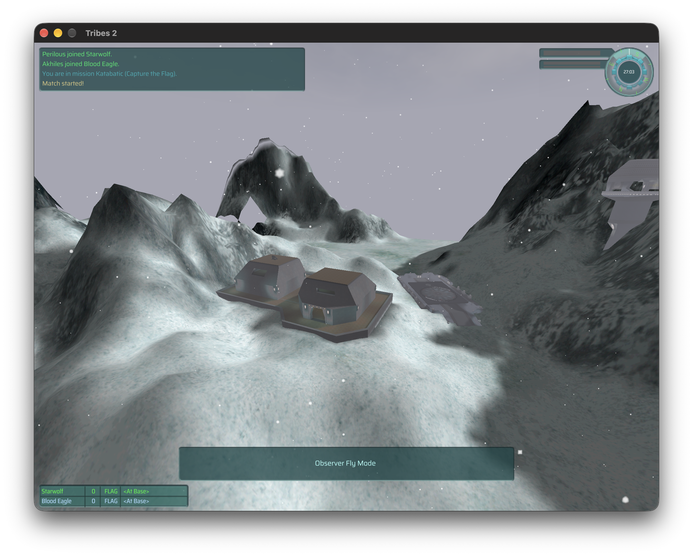

# TribesPad

Tribes 2 on iPad, iPhone and Mac, using the original game and TribesNEXT client.

TribesPad translates the original x86 game ahead of time into native ARM64 code
and supplies the Windows, graphics, audio and network services it expects on Apple
platforms. The aim is the original game, offline bot matches and compatibility with
the existing Tribes 2 community, with touch and controller support on mobile.

**In development.** The Mac app renders and runs offline matches, but performance
is currently too slow for comfortable play. The full iPad Simulator app starts the
original engine but stops during graphics setup;
there is no playable iPad or iPhone release yet.



## What works

- **Original Mac menus and rendering.** The game runs in a signed native Mac app,
  with corrected mouse targeting on Retina displays.
- **Offline matches on Mac.** Katabatic loads with two bots. Movement, aiming and
  disc firing have been exercised through native keyboard and mouse input.
- **Internet server listings.** The original browser lists 26 community servers
  and refreshes their information. No online match has been joined in these tests.
- **iPad app integration.** The full original engine builds and starts in the iPad
  Simulator. Its checked GL4ES bridge passes real pixel readback and context
  lifecycle tests. GPU-query setup currently blocks the original menu.

## Current work

- Measure game performance with the optimized, cached ARM64 build.
- Connect the full original engine to the iPad renderer and app lifecycle.
- Integrate and refine touch, controller, keyboard and mouse input in real gameplay.
- Verify HD textures, sustained performance and physical-device behavior.

Offline testing and server discovery are the current multiplayer-related checks;
authenticated online play remains unverified. Detailed results and remaining issues
are in [status](docs/STATUS.md) and the [execution plan](docs/EXECUTION-PLAN.md).

## Build from source

The development build needs Xcode, pinned LLVM tools, prepared game inputs and
translated images. A clean checkout is not yet a one-command build.

In the prepared workspace, build and package the Mac app with:

```sh
export DEVELOPER_DIR=/Applications/Xcode.app/Contents/Developer
export SDKROOT="$(xcrun --sdk macosx --show-sdk-path)"
.venv/bin/python scripts/test-qol-native-bootstrap.py \
  generated/srw/run-20261003T190924-ifc22 --probe-ntdll --enter-engine
.venv/bin/python scripts/build-macos-engine-app.py
open generated/integration-review/macos-engine-app/TribesPad.app
```

The app currently uses assets in that workspace. There is no standalone release or
verified device IPA installation flow. The separate Apple controls diagnostic does
not contain the full game.

Build details, native input helpers and component checks:
**[Development guide](docs/DEVELOPMENT.md)**.

## Game files and references

Game data is not included in this repository. Downloads, textures and generated
translations stay under ignored `ref/` and `generated/` directories.
[Input hashes](inputs-manifest.json) identify the selected game and TribesNEXT files;
[dependency pins](dependencies.lock.json) include the
[HaloPad / ProjectReach](https://github.com/chrissotraidis/projectreach) reference.
Free download availability does not grant redistribution rights.

See the [product target](docs/Tribes2-Online-HD-Target.md) for the intended experience.
Problems: [open an issue](https://github.com/chrissotraidis/tribespad/issues).
