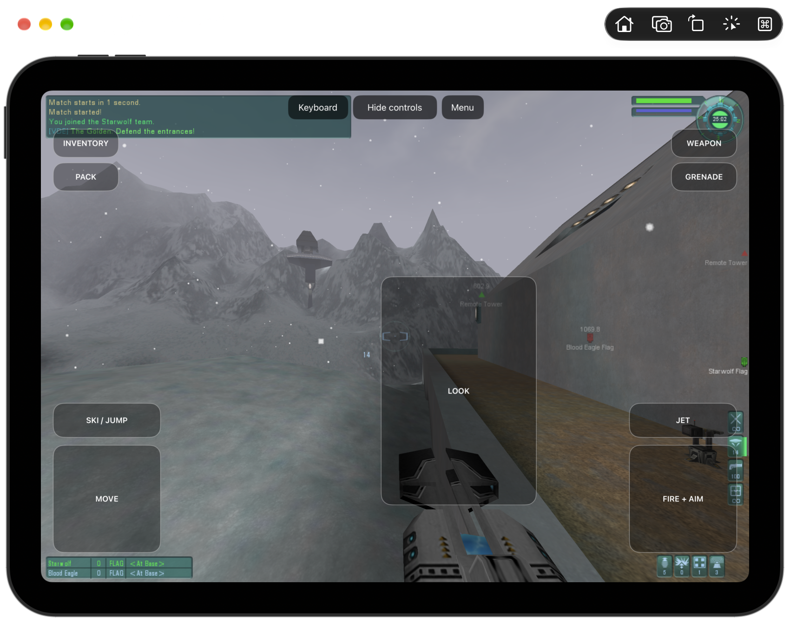

# TribesPad

**Project handoff:** [What works, remaining blockers, and the next reviewer’s starting point](docs/HANDOFF.md). Development is paused for review; the game is not release-ready.

Tribes 2 on iPad, iPhone and Mac, using the original game and TribesNEXT client.

TribesPad translates the original x86 game ahead of time into native ARM64 code
and supplies the Windows, graphics, audio and network services it expects on Apple
platforms. The aim is the original game, offline bot matches and compatibility with
the existing Tribes 2 community, with touch and controller support on mobile.

**In development.** The Mac app and full iPad Simulator app run original offline
matches with bots. iPad touch movement, aim, weapons, firing, jets and respawn
have been exercised. Recent fixed-view tests run at **6–9 FPS in the Simulator**, with
slow loading and input delay. Physical-iPad gameplay is unverified; there is no
playable iPad or iPhone release yet.



## What works

- **Original Mac game.** Menus, Retina mouse targeting and offline Katabatic
  matches with bots. Movement, aiming and disc firing have been exercised.
- **Internet server listings on Mac.** The original browser displayed 26 community
  servers and refreshed their information. Tests do not join online matches.
- **Original iPad game in Simulator.** The Metal renderer loads Katabatic with bots.
  Touch movement, aiming, weapon switching, firing, jets and respawn work.
- **Offline inventory and reload.** Two maps load in the same iPad app session.
  Touch selects equipment, and station equipment changes and exit pass with
  [diagnostic positioning for the station test](docs/validation/ipad-offline-reload-inventory.json).
- **Original audio data.** WAV loading and the MP3 window tables are repaired.
  Original UI/loading samples match the game archive, and music supplies nonzero
  PCM to OpenAL. Audible quality still needs validation.
- **Clean iPad shutdown.** The original **Launch → Quit** path completes
  worker and DLL cleanup, including after an offline match, and the app can
  reopen its saved profile.
- **Saved profiles.** The bundled iPad app keeps warrior and video preferences
  between launches. Its device build includes the game files it needs locally.

## iPad controls

To try an offline match, choose **LAN GAME → HOST → Katabatic**, enable two bots,
and tap **START GAME**. Loading currently takes several minutes. Once the world
appears, tap **Touch controls**, then **Fire + Aim** to spawn.

| Control | Action |
| --- | --- |
| Move pad | Move with the original ESDF bindings |
| Look pad | Drag to aim |
| Fire + Aim | Hold to fire; drag to aim while firing |
| Jet | Hold to jet; release to recover energy |
| Ski / Jump | Original jump action |
| Weapon | Switch weapon |
| Inventory | Open inventory and hide the gameplay pads so its fields can be tapped |
| Menu | Send Escape to the original game, including when the pads are hidden |
| Keyboard | Show the onscreen keyboard for a selected text field |

Movement, look, weapons, fire and jet have been exercised in the Simulator.
Skiing, simultaneous gestures and physical-device responsiveness still need validation.
The bundled app preserves its original warrior and video preferences between launches.
In inventory, tap the original **Done** button, then **Touch controls** to resume.
Use **Hide controls** when another original dialog needs direct taps. The toolbar
stays reachable while the onscreen keyboard is open. To close the game, choose
**Launch → Quit** in the original menu.

## Controller layout

The full app maps one extended Xbox, PlayStation or MFi gamepad to the original
bindings. Native input tests and both iPad builds pass; physical-controller
and physical-iPad gameplay are still unverified.

| Control | Action | Control | Action |
| --- | --- | --- | --- |
| Left stick | Move | Right stick | Aim |
| RT | Fire | LT | Jet |
| A | Ski / jump | X | Use pack |
| LB | Grenade | RB | Next weapon |
| Y | Inventory | Menu | Escape |

Disconnecting releases the controller's actions; backgrounding releases all controls.
Touch controls remain available alongside the controller.

## Build from source

The development build needs Xcode, pinned LLVM tools, prepared game inputs and
translated images. A clean checkout is not yet a one-command build.

In the prepared workspace, boot one iPad Simulator and build the full app:

```sh
export DEVELOPER_DIR=/Applications/Xcode.app/Contents/Developer
export SDKROOT="$(xcrun --sdk iphonesimulator --show-sdk-path)"
.venv/bin/python scripts/build-ipad-engine.py --angle --cpu-host-checks \
  --bundle-assets --simulator-device <UDID>
```

`--angle` selects the pinned Metal renderer. `--bundle-assets` gives the Simulator
its own game files and writable profile. Add `--build-only` to preserve a running
session. For a self-contained ARM64 device build:

```sh
export SDKROOT="$(xcrun --sdk iphoneos --show-sdk-path)"
.venv/bin/python scripts/build-ipad-engine.py --platform device --angle \
  --cpu-host-checks --build-only
```

The device app needs Apple development signing before installation; it is not an
installable release. Mac packaging, dependency preparation, signing requirements
and build validation: **[Development guide](docs/DEVELOPMENT.md)**.

## Status and limits

- A same-view iPad Simulator comparison improved observer frame delivery from
  **7.4 to 8.8 FPS** (two 30-second recordings per build, offline Katabatic, two bots).
  Memory checks remain enabled. This is a Simulator recording measurement, not
  physical-device performance; startup, input delay and sustained speed still need work.
- A follow-up compiler optimization removes redundant checks on bounded native
  arrays, but its 7.3 versus 7.4 FPS recordings overlap and establish no further
  gameplay speedup.
- MMX arithmetic now uses native vectors and is about 55% faster in isolation.
  Latest game recordings measure 5.84/7.37 FPS; a gameplay speedup is unproven.
- Distance fog is fixed. HD texture uploads are verified, but full visual fidelity
  is not accepted.
- Both iPad targets build with an optimized executable of about **104 MB**, down
  from 158.6 MB. Verified object caching speeds up rebuilds; guest-memory checks
  stay enabled.
- Physical-iPad installation, memory usage and gameplay are unverified. The full
  iPhone game has not been accepted.
- Automated multiplayer checks stop at server discovery. Online joining and
  authentication remain unverified.

Engineering detail and current evidence live in [status](docs/STATUS.md), the
[execution plan](docs/EXECUTION-PLAN.md) and [validation records](docs/validation).

## Game files and references

Game data is not included in this repository. Downloads, textures and generated
translations stay under ignored `ref/` and `generated/` directories.
[Input hashes](inputs-manifest.json) identify the selected game and TribesNEXT files;
[dependency pins](dependencies.lock.json) include the
[HaloPad / ProjectReach](https://github.com/chrissotraidis/projectreach) reference.
Free download availability does not grant redistribution rights.

See the [product target](docs/Tribes2-Online-HD-Target.md) for the intended experience.
Problems: [open an issue](https://github.com/chrissotraidis/tribespad/issues).
