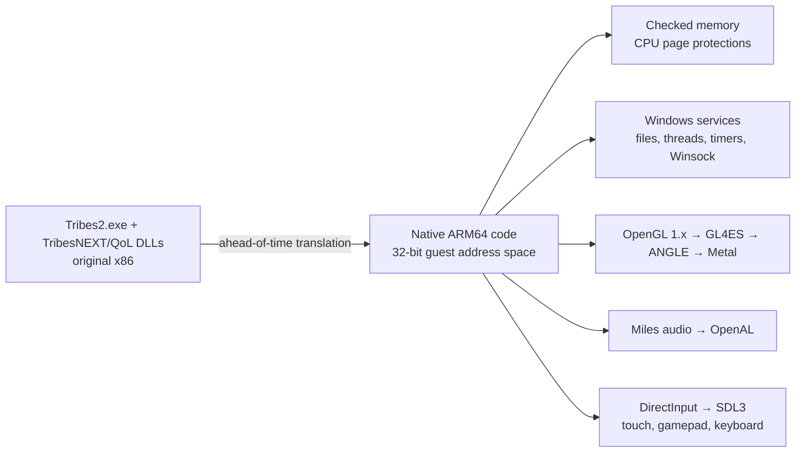

<p align="center">
  
</p>

<h1 align="center">TribesPad</h1>

<p align="center">
  <strong>The original Tribes 2, native on iPad, iPhone and Mac.</strong><br>
  Jetpacks, skiing and capture the flag, translated ahead of time from x86 to native ARM64 and rendered through Metal, with touch controls and gamepad support.
</p>

<p align="center">
  
  
  
  
  
  
  
</p>


> [!IMPORTANT]
> **TribesPad is in development and has no release yet.** Offline matches against
> bots play by touch in the iPad Simulator at about 30 FPS, and the Mac build runs
> the original game. Physical iPad, iPhone and controller play have not been
> verified, and online joining is not yet tested. Building requires your own
> prepared Tribes 2 and TribesNEXT files; no game data is included.

## What is TribesPad?

TribesPad runs the **original Tribes 2 executable and the TribesNEXT / QoL client**
on Apple devices. It does not run a CPU emulator and is not a remake: the
game's x86 code is translated ahead of time into native ARM64, and TribesPad supplies
the Windows, OpenGL, audio, input and networking services the game expects. The
original menus, maps, weapons, physics, bots and scripts are all the game's own.

On iPad it adds an analog touch layout, gamepad mapping and a small TribesPad menu
for settings; iPhone support is planned. On Mac it runs as a normal app with mouse
and keyboard.

## Screenshots

| | |
|---|---|
|  |  |
| **Katabatic**, original terrain, fog and snow through Metal | **Base interiors** with the original lighting and HUD |
|  |  |
| **Inventory**: touch controls step aside so the original screen can be tapped | **TribesPad menu**: control size, opacity, look sensitivity, left-handed layout, FPS counter |

## Current status

| Question | Answer |
|---|---|
| Is this an emulator or streaming? | Neither. The x86 game and DLLs are translated ahead of time into native ARM64 code. Memory permissions are enforced by the CPU's page protections, and any access that breaks them stops the game. |
| Can I play it today? | **In the iPad Simulator, yes:** host an offline match with bots and play it by touch at about 30 FPS. The Mac app runs offline matches with mouse and keyboard. There is no installable iPad or iPhone release yet. |
| Does it work on a real iPad or iPhone? | **Not verified.** The iPad device build compiles, but it has not been installed or played on hardware. The iPhone layout has not been checked. |
| What has been played? | Offline Katabatic CTF with two bots: spawning, movement, aiming, firing, jets, skiing/jumping, weapon switching, grenades, inventory, an end-of-match map change, and a clean quit. A 30-minute session ran without a crash. |
| Does it match the original game? | In the one scenario measured so far, yes: a [reference trace](docs/validation/reference-trace-katabatic.json) of the same Katabatic flight is bit-identical to the original Windows game in the air and differs by about 1 cm after landing, where the QoL collision patch applies (the Windows reference ran without QoL). |
| Online play? | The original server browser lists TribesNEXT community servers on Mac. Joining online matches and account sign-in have not been tested. |
| Controllers? | One Xbox, PlayStation or MFi extended gamepad maps to the original bindings. Native input tests pass; play with a physical controller is unverified. |
| Is the game included? | **No.** You need your own Tribes 2 installation and the TribesNEXT client files. See [Game data](#game-data). |

### Performance

Performance went from unplayable to steady in the Simulator:

| Build | Offline Katabatic, iPad Air 11-inch (M4) Simulator |
|---|---|
| Software-checked memory (start) | 6–7 FPS, 221 s map load |
| Page-protection memory checks | ~20 FPS |
| + lighter GL checks, draw streaming, texture-upload ring, faster float paths | **~30 FPS** steady, worst frames 50–90 ms, ~70 s map load |

The steady 30 FPS is the vertical-sync pacing: with VSync off the same match runs
36–37 FPS. Physical-device numbers will differ. Details are in the
[handoff](docs/HANDOFF.md) and [performance records](docs/validation/ipad-hardware-permissions.json).

## Play an offline match

1. Choose **LAN GAME → HOST → Katabatic**, enable two bots and tap **START GAME**.
2. When the world appears, tap the **controller button** at the top to show the touch controls.
3. Tap **Fire** to spawn.


### Touch controls

| Control | Action |
|---|---|
| **Move stick** (bottom left) | Analog movement |
| **Right side of the screen** | Drag anywhere that is not a button to aim |
| **Fire** (bottom right) | Hold to fire; drag to aim while firing |
| **Jet · Ski / Jump · Grenade · Weapon** | The ring around Fire |
| **Pack · Inventory** | Above the move stick; Inventory hides the controls so the original screen can be tapped |
| **Controller / X button** | Show or hide the touch controls |
| **Keyboard button** | Onscreen keyboard for chat and text fields |
| **··· menu** | Game Menu (Escape), Console, touch-control settings, FPS counter, help |

In Inventory, tap the original **Done**, then the controller button to resume. To
close the game, use **Launch → Quit** in the original menu.

### TribesPad menu

| Section | Options |
|---|---|
| Game | Game Menu (original Escape menu), show/hide touch controls, original console |
| Touch Controls | Size, opacity, look sensitivity, left-handed layout, hide with a controller |
| Display | FPS counter |
| Help | TribesPad on GitHub, About |

### Controller layout

| Control | Action | Control | Action |
|---|---|---|---|
| Left stick | Move | Right stick | Aim |
| RT | Fire | LT | Jet |
| A | Ski / jump | X | Use pack |
| LB | Grenade | RB | Next weapon |
| Y | Inventory | Menu | Escape |

Disconnecting releases the controller's actions, and backgrounding the app releases all controls.

## Recompiled, not decompiled

TribesPad contains no Tribes 2 source code, original or reconstructed. It works
from the game's shipped Windows machine code:

1. **Input.** The original x86 binaries: `Tribes2.exe`, the TribesNEXT/QoL client
   DLL and the Miles audio DLL and codec plugins.
2. **Lift.** Each x86 code block is converted into compiler intermediate code
   (LLVM IR), one function per original block, keeping the game's exact 32-bit
   memory layout.
3. **Compile.** That code is compiled ahead of time to native ARM64 and linked
   with the TribesPad runtime. Nothing is interpreted or just-in-time compiled
   while you play.

Around the translated game, TribesPad supplies what Windows and the PC used to:
the Windows API functions the game calls (files, threads, timers, memory,
sockets), OpenGL through GL4ES and ANGLE to Metal, exact x87 floating point,
DirectInput through SDL3, and Miles audio through OpenAL. The QoL client patches
the engine's code while it runs; each of those patches was captured and
translated in advance, so code written at run time is never executed.

This differs from decompilation ports, which rebuild readable C source and
then modify it. TribesPad keeps the original program's behavior instruction for
instruction, which keeps it faithful to the original and is what should keep it
compatible with TribesNEXT servers (joining a server is not yet tested).

## How it works



- **Memory checks the CPU enforces.** The game's 32-bit address space keeps exact 4 KiB
  Windows page permissions. Pages are protected in hardware, mixed pages are checked in a
  fault handler, and any violation stops the game.
- **Original rendering.** The game's fixed-function OpenGL runs through GL4ES and ANGLE
  on Metal, with streaming paths added for draws and texture uploads.

## Game data

TribesPad does not include Tribes 2 or TribesNEXT. Downloads, textures and generated
translations stay in the ignored `ref/` and `generated/` directories. The selected
files are identified by hash in [inputs-manifest.json](inputs-manifest.json), and pinned
dependencies are in [dependencies.lock.json](dependencies.lock.json). That a game is
available for free download does not grant redistribution rights.

## Build from source

The build needs Xcode, the pinned LLVM toolchain, prepared game inputs and translated
images. A clean checkout is not yet a one-command build. In a prepared workspace, with
one iPad Simulator booted:

```sh
export DEVELOPER_DIR=/Applications/Xcode.app/Contents/Developer
export SDKROOT="$(xcrun --sdk iphonesimulator --show-sdk-path)"
.venv/bin/python scripts/build-checked-bochs.py --platform simulator --hardware
.venv/bin/python scripts/build-ipad-engine.py --angle --hardware-permissions \
  --bundle-assets --build-only
# Output: generated/ipad-engine-hw/TribesPad.app
```

For a physical iPad build, use the `iphoneos` SDK with `--platform device`; the app
then needs Apple development signing before installation. Mac packaging, dependency
preparation and validation are covered in the [development guide](docs/DEVELOPMENT.md).

## Roadmap

- Install and play on a physical iPad; decide the VSync default on hardware
- Check the iPhone touch layout
- Play with a physical controller
- Touch layout editor
- Rebuild the Mac app on the current engine and measure Mac performance
- Compare with the QoL client on Windows and add jet, weapon and bot scenarios to the reference trace
- Join TribesNEXT community servers
- A distributable build

## Documentation

- [Handoff](docs/HANDOFF.md): what works, current evidence and next steps
- [Development guide](docs/DEVELOPMENT.md): building, packaging and validation
- [Validation records](docs/validation): measurements and screenshots
- [Product target](docs/Tribes2-Online-HD-Target.md): the intended experience
- [Archive](docs/archive): historical status checkpoints, plans and rejected experiments

## Credits

Tribes 2 was developed by Dynamix and published by Sierra. Thanks to the
[TribesNEXT](https://www.tribesnext.com) community, which keeps the game and its
servers alive. Touch control design follows HaloPad /
[ProjectReach](https://github.com/chrissotraidis/projectreach) and SunPad.

The project does not yet have a license; until one is added, all rights are reserved.

TribesPad is an unofficial fan project and is not affiliated with or endorsed by
the owners of Tribes 2. Report problems in [issues](https://github.com/chrissotraidis/tribespad/issues).
