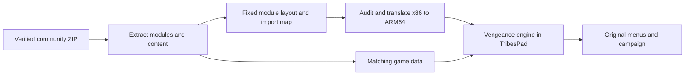

# Vengeance implementation plan

29 October 2026, inspected against TribesPad `3f284ee`.

Build **our native Vengeance engine inside the existing TribesPad app**, selectable
beside Starsiege: Tribes and Tribes 2. Reuse the app, touch overlay, controller
handling and translation tools. Translate the game's native Windows modules;
retain its UnrealScript packages, campaign assets and original game behavior.
One selected engine runs per launch. This is planning: Vengeance does not yet
link, launch or play in TribesPad.

This is the specific next-work plan for Vengeance. The
[combined plan](VENGEANCE-ASCEND-PLAN.md) still covers Ascend and shared packaging;
[feasibility](VENGEANCE-FEASIBILITY.md) preserves the initial executable findings.
The [new static evidence](validation/vengeance-planning-audit-2026-10-29.json)
records config identities, bindings, campaign targets and a candidate module map.

## What the player would get

1. Build TribesPad with the optional Vengeance engine and verified game data.
2. Choose **Tribes: Vengeance** in the existing game picker. Keep its card, focus,
   controller navigation and disabled-state styling consistent with the others.
3. Enter Vengeance's own menus: create a profile, start or continue the campaign,
   or use its multiplayer browser once online compatibility is validated.
4. Play with the existing movement stick, look surface, fire/jet controls and
   utility menu, using Vengeance-specific actions. Mouse/keyboard remains available.
5. Keep Vengeance saves/settings separate. Choosing another game releases input,
   flushes supported state and closes the session; reopening shows the picker.

The first useful release candidate is campaign gameplay with saves and controls.
Community multiplayer is a separate acceptance milestone, not discarded work.
Do not advertise complete campaign compatibility after testing one mission, or
ready multiplayer bots from the existence of campaign AI. Add a playable card
only when the engine and its matching data have passed the relevant checks.

## Inputs we can start with

The [Reddit guide](https://www.reddit.com/r/Tribes/comments/cjgze1/how_to_play_tribes_all_games/)
points to the [community download](https://downloads.tribesrevengeance.net/TribesVengeance.zip).
The [maintainers' page](https://tribesrevengeance.net/downloads/revengeance/)
says the current build includes both single-player content and the Engine.dll
fix. Start with this coherent package; do not add the old standalone campaign
or Engine patch automatically. Both pages were checked on 29 October.

The cached ZIP was rehashed this pass: 3,093,197,450 bytes,
SHA-256 `22180a8162caccc059c81aac86ad7c3e26b854e01f080534eb774b0ce088fc52`.
The 27 selected module hashes match the previous audit. Full campaign assets
still need extraction and validation; the earlier extraction covered binaries
and configuration. Use the publisher free-download history and distribution
findings already recorded in [expansion research](TRIBES-EXPANSION-RESEARCH.md#follow-up-free-downloads-repackaging-and-the-tribes-2-precedent).
No additional permission question is needed to continue investigating these inputs.

Implement `scripts/vengeance/prepare.py` and `config/vengeance/inputs.json`
(proposed files, not existing commands): resumable fetch or local archive import,
hash verification, safe ZIP/Inno extraction, and a manifest of selected files.
Retain notices and the original `Program/Bin` / `Content` hierarchy. Record the
extractor version and its build dependency. Reject corrupt input and escaping
archive paths; never run the installer or included key utilities to extract data.
Publish scripts, manifests and our app code, keeping game bytes and translated
game output in ignored local build folders.

This is the owner's port in `chrissotraidis/tribespad`, not a wrapper/catalog entry
for another person's app. This planning change adds no PadMint entry or workflow
choice. Any future PadMint addition needs the owner's explicit go-ahead under the
current repository rules; a local engine experiment is not that addition.

## Translation and startup

Native `.exe`/`.dll` code goes through the audit → SRW → LLVM → ARM64 pipeline.
Unreal `.u`/`.pkg` data is loaded by the translated engine; it is not another PE
module. Inventory script/native package pairs and dynamic loads explicitly.
There is a `Physics.u` and Havok data in the installer, but no `Physics.dll` in
the inspected binary inventory. Trace the actual engine/Movement physics path;
do not substitute different physics merely to get a scene moving.

### Start with seven modules and a fixed layout

UCC's packaged static dependency closure is **UCC, Core, MSVCR71, MSVCP71, ogg,
vorbis and vorbisfile**. The old shorthand "UCC + Core" did not mean two files.
Start by translating these libraries together, preserving their 32-bit ABI and
allocator ownership. Supply Win32 services through TribesPad. Replacing codec
or CRT functions with native implementations is a later, measured choice;
import-name matching alone does not justify mixing allocators or C++ objects.

The evidence JSON contains a **candidate**, unexecuted layout for the 27 known
client/UCC modules: keep UCC at `0x00400000` and the client at `0x10900000`, place
DLLs from `0x11000000` on 64 KiB boundaries, ending at `0x12260000`. Known image
ranges are disjoint, and every moved DLL has relocation entries. UCC has none,
so leave its preferred address intact. MSVCR71/MSVCP71 originally sit around
`0x7c340000`; those addresses fall in the current runtime's virtual-allocation
domain, not its static image area. Relocate them too.

Before adopting this map, combine it with the actual provider/thunk, stack,
TEB/PEB, scratch and heap reservations in
[guest_address_space.c](../port/core/guest_address_space.c) and the selected
engine bootstrap. Freeze a versioned manifest, then append subsequently discovered
dependencies without silently reshuffling existing entries. Validate relocation
types and every import/export/ordinal/forwarder. Keep source files immutable;
rebase copies **before** auditing and generating absolute literals/dispatch tables.
Check cross-module function pointers, DLL initialization order and termination.

Cross-compile the bootstrap for device and Simulator early, alongside Mac startup.
Check the selected engine's reservation and checked-memory backend on iOS before
committing to large assets; a Mac address reservation is not device validation.
Do not assume Starsiege's 4 GiB reservation or an extra entitlement is required
for Vengeance just because that harness is the starting example.

Reuse the small host harness pattern from
[starsiege_engine.c](../port/starsiege/starsiege_engine.c), replacing its addresses,
entry point, startup metadata and module registry with Vengeance's manifest.
Adapt the pinned HaloPad guest SEH support to TribesPad's CPU/stack contracts.
Exercise an actual MSVC71 throw/catch/unwind path and DLL constructors; neither
empty exception handlers nor silently successful missing imports count.

### Investigate the client at the same time

The client PE entry is **`0x10916b0c` in `.text`**. The previous diagnostic SRW
abort was **`0x109be6d8` in `.kpjaig`**, a different executable section. A static
decode failure there does not establish that the failure is reached at startup.
Trace entry/call roots and references into that section; classify code/data and
initialization behavior before choosing a correction. Do not exclude the entire
section, replace it with no-ops or claim a protection bypass is required from
entropy alone. Any required runtime-generated x86 code needs a verified build-time
translation strategy; an iOS JIT is outside this plan.

UCC is the first cheap executable test, **not a gate that postpones learning
whether the client can work**. After UCC prints a meaningful command-line response,
attempt an engine/package load with the configured NullRenderDevice if supported.
Bound that experiment; if its commandlet route cannot initialize gameplay, move
to the client with instrumentation rather than growing a separate server port.

For instruction work, start with the reached UCC/Core gaps (`movntq` stores and
prefetch hints), then engine/SSE paths. D3DDrv's 2,533 unsupported sites include
many 3DNow routines. Verify CPU feature dispatch before investing in unused
alternatives; implement the semantics of every reachable data operation. A
diagnostic translator exit 0, an object file or a no-op renderer is not startup.

## First playable slice

The actual `Campaign.ini` has 16 chapter comments and 33 mission entries. Its
opening sequence names `CS-00SPAstart` → **`SP-Spaceship`** →
`CS-01SPAend_02CAPstart`. Those maps and `Entry.tvm` occur in the installer list.
This gives a concrete first campaign route; listing entries does not validate
their dependency closure or gameplay. `Default.ini` also names `Index.tvm`, but
it was not found under that name in the installer listing: observe the real menu
startup instead of manufacturing that file or assuming it is necessary.

Extract the full content for the first engineering build. Preserve maps, art,
sounds, music, localisation, Havok data, classes and in-engine cutscenes. Trace
opens during the first slice before attempting a smaller content package. A
direct map launch may be useful for diagnosis but does not prove the New Game,
profile, cutscene or campaign-transition route works.

Adapt the already pinned HaloPad D3D9/Metal implementation and DirectInput8A
provider. Capture actual device caps, shader versions, render targets, texture
formats and state usage. Vengeance's config enables hardware vertex processing,
cubemaps and compressed lightmaps; do not claim compatibility by changing flags.
Verify terrain, skinned characters, lighting, effects, HUD and menu rendering.
Keep the existing T1/T2 OpenGL route working. The overlay's FPS/frame callbacks
currently call `tribes_gl4es_*`; add an explicit active-renderer adapter so a D3D9
game is not measured or controlled through the dormant GL renderer.

Use the existing OpenAL host provider after checking ALAudio's actual imports and
dynamic symbol requests. Verify codec callbacks, sample formats, music streaming,
dialogue, spatial effects and interruption/resume. The full slice passes only
when movement, skiing/jetpack, firing, AI/collision and audio work, a save survives
quit/relaunch, and the opening campaign sequence can progress. Grappler, vehicles,
later missions and full campaign completion remain separate acceptance items.
If the opening segment withholds equipment, use a second identified mission or
loadout to verify those actions; do not mistake a campaign restriction for a port
failure or silently grant equipment in the normal campaign route.

## Controls that feel like TribesPad

The following are proposed host bindings grounded in `DefUser.ini` and `User.ini`,
whose selected bindings agree in the inspected package. Effective profile loading
and rebinding still need a runtime check. Keep physical keyboard defaults intact.

| Action | Proposed touch control | Proposed controller control | Inspected guest input |
| --- | --- | --- | --- |
| Move / look | Existing left stick / look surface | Left / right sticks | WASD / relative mouse |
| Fire | Existing fire button, retain look dragging | RT | Left mouse; preserve release behavior |
| Jet / jump | Existing Jet button, hold | LT | Right mouse: `Jetpack` and `Jump` |
| Ski | Dedicated Ski button, hold | LB; A can be an alternate | Space; this is **not** a second jump binding |
| Grenade | Grenade button, hold/release | Y | E; `altFire` with release handler |
| Activate pack | Pack button | X | Q |
| Use / interact | Separate Use button | B during gameplay | F |
| Next / previous weapon | Weapon button / utility choice | RB / D-pad left | Mouse wheel down / up |
| Zoom / change zoom | Utility control | Right stick click / D-pad up | Ctrl hold / R press |
| Objectives / loadout | Utility menu | D-pad down / right | C / Shift; verify context |
| Pause / back | Existing menu control | Menu; B in menus | Escape |
| Save / load | Original pause menu; optional campaign shortcuts | Original menu | F5 / F8 exist in defaults |

Keep jet, ski and fire independent. LB ski lets the player use both sticks while
skiing and firing. If A is also bound to ski, combine A/LB held state before
emitting events so releasing one does not release the other. Touch defaults need
a real comfort test while moving, aiming, firing, jetting and skiing; an explicit
optional ski toggle may help, but must not become an invisible always-on action.

The existing nine-key override in
[mobile_controls.c](../port/apple/mobile_controls.c) is only a starting point.
It cannot express wheel-based weapon cycling and all separate actions by itself.
Add the smallest per-game binding description needed for key, mouse-button and
wheel events, with explicit labels and press/release behavior. Keep the current
T1/T2 mappings intact. Do not map Pack and Use onto the same action merely because
the current internal enum calls the pack action `TBUse`.

[mobile_controls.m](../port/apple/mobile_controls.m) also assumes either T1 or T2
for game state, quick chat, command menus, stats and community links. Give Vengeance
an explicit profile. Begin with its own game menus and manual overlay toggle;
add a narrow, versioned game-state adapter for gameplay/menu/text-entry/cutscene
states. Investigate a read-only host hook first; any UnrealScript change needs
compatible tooling and a multiplayer compatibility check. Do not parse Torque
state files or inject Torque commands into this engine.

Release all held inputs on menus, loading, cutscenes, backgrounding, controller
disconnect and Choose Game. Restore only fresh input after returning. Preserve
menu pointer/text-entry behavior, focus and safe areas; no stuck jet/grenade/zoom.
Account for user rebindings: either use a clearly named, editable TribesPad profile
or resolve the effective bindings. Never rewrite player settings on each launch.

## Same app and save ownership

Use `GameData/Vengeance` for bundled assets and
`Application Support/TribesPad/Vengeance` for writable state. Resolve Windows-style
relative/case-insensitive paths consistently on Mac/iOS. The startup INIs add
content search roots; `Default.ini` uses `../Saves` and the package contains
`Content/System/Profiles/Default.ini`. Trace opens/writes to establish which virtual
directory each path resolves against. Whitelist observed config/profile/save/cache
locations into writable storage; leave bulk assets in the bundle. Preserve saves
across app/data upgrades, rejected inputs and game changes.

On Mac, bundle a `VengeanceEngine` executable and launch it through the existing
picker/exec route. On iOS, follow the
[Starsiege object-localization pattern](../scripts/starsiege/build_engine.py),
exporting only `vengeance_mobile_engine_main`; select it in
[mobile_engine_main.m](../port/apple/mobile_engine_main.m) before engine startup.
Audit Objective-C/global/TLS callbacks and shared SDL/Metal/audio ownership as
well as C symbols. Only allocate the chosen engine's guest state.

Extend [launcher.h](../port/apple/launcher.h), both picker implementations,
[build-tribespad.sh](../scripts/build-tribespad.sh) and the app packager only after
the standalone engine slice works. The future selection is
`--games tribes2,starsiege,vengeance`; **it is not supported today**. Retain current
defaults, use stable IDs instead of two-card indexes, and require both a compiled
engine and validated data. A requested Vengeance build failure must be explicit,
with previous working outputs preserved. A ZIP downloaded onto a signed phone
cannot add a missing compiled engine.

## Implementation order and evidence

Each row can span several small PRs; the evidence determines completion.

| Step | Concrete work | Required result |
| --- | --- | --- |
| V0 Inputs | Add preparation script/input manifest; extract content; record tools and hashes | Fresh staging and local archive import agree; corrupt input fails; no dependency on ignored research caches |
| V1 Layout and audit | Validate/freeze the 27-module candidate map, provider reservations, imports and relocation copies | Disjoint full runtime map; pointer/ordinal/forwarder checks; regenerated audits tied to layout hash |
| V2 First execution | Translate seven UCC modules; implement reached CRT/Win32/SEH/instruction contracts | Native ARM64 command-line response and repeatable termination; first unimplemented path recorded |
| V2b Client investigation | Begin alongside V1/V2; trace `.text` entry and `.kpjaig` references | Explain decode failure/reachability and produce a concrete client-startup route; no blanket section exclusion |
| V3 Engine and graphics | Native package/VM/physics startup, D3D9/Metal, input and OpenAL | Original menu and a rendered controllable campaign scene with sound; no fake physics/API success |
| V4 Campaign slice | Profile, opening cutscene/mission, interactions, save/reload and transition | Reproducible route through the normal menus; save resumes after process restart |
| V5 App and controls | Third engine/picker, isolated data, touch/controller profile and lifecycle | Same app launches T1, T2 and Vengeance separately; existing saves/settings still work |
| V6 Online | Original browser/direct join and community content/version compatibility | Real server join, playable session, disconnect/reconnect; prior UDP responses alone do not pass |
| V7 Player build | Physical iPhone/iPad, clean build, measured resources and release prerequisites | Named-device evidence for touch/controller, frame times, peak RAM, heat, load time and failures; honest supported scope |

At V1/V2, add meaningful semantic tests for rebasing/imports, cross-module callbacks,
CRT unwinding and newly implemented instructions. At V5, extend input tests for
overlapping held actions, wheel pulses, quick taps and cancellation; exercise
missing-data/failed-selection paths and the T2-only/default/three-game builds.
Do not rerun a full unchanged game build just for this planning document.

Log tool/input/layout identities, command, first reached failing guest PC and
behavior verified for every execution experiment. Record ordinary failure as
failure; unsupported-call traps are useful diagnostics. Build/link, Simulator
screenshots and physical gameplay are separate checks. Avoid a completion date
until client startup and the first map establish the real remaining work.

Measure disk/build/IPA cost for the added engine. The existing 20 GiB allowance
only covers the old selection; the Vengeance ZIP alone adds roughly 3.1 GB before
extraction and native outputs. Preserve recipe-only publication. Before any future
PadMint game release, run its current-main `scripts/player-check.sh` from
`/Users/chrissotraidis/GitHub/padforge` with a clean game checkout before tagging,
then without it after publishing, using Apple's Python 3.9 and an empty PadMint
folder. That release check does not replace device acceptance.

## Next bot start here

Begin with **V0 and V1**, using the new evidence JSON as a candidate, not a loader
already implemented. Verify the seven-module UCC closure and resolve the complete
address reservations before generating translated output. Start the bounded
client entry investigation in the same work session. Leave a small implementation
PR with reproducible commands, the first reached failure and the next experiment.
Do not repeat the broad game-selection research or build a picker-only prototype
and call Vengeance integrated.
