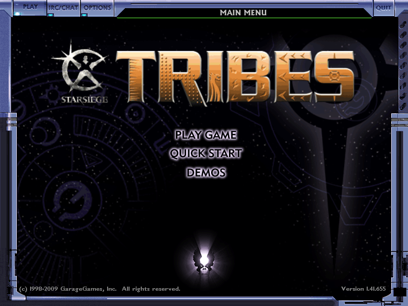
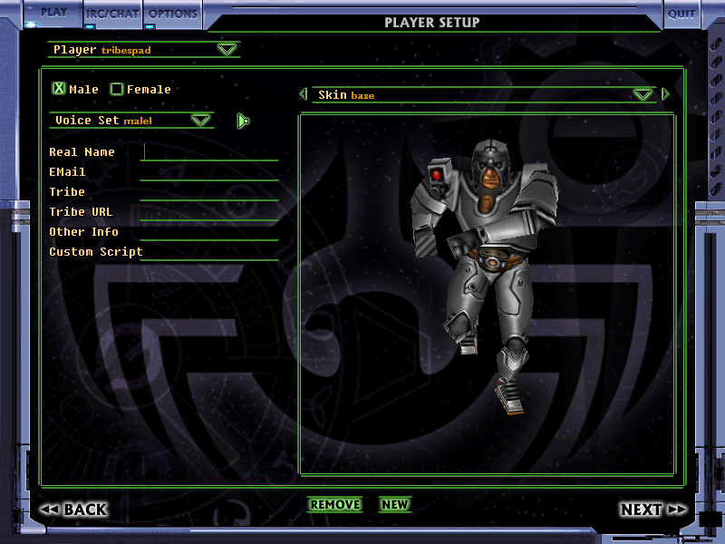
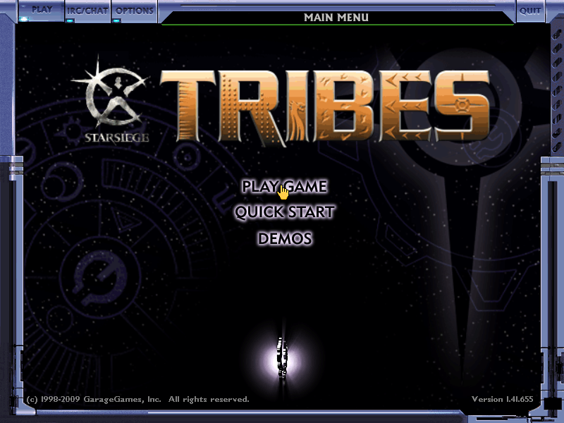

# Starsiege: Tribes G2 record (24 October 2026)

Gate G2 in [STARSIEGE-TRIBES-PLAN.md](../STARSIEGE-TRIBES-PLAN.md): lift 1.41 and reach the main menu. **The original main menu renders** from the translated 1.41 `Tribes.exe` on this Mac, headless: no window was shown and nothing appeared on screen or in the Dock.

## What runs

- `scripts/starsiege/build_engine.py` puts the lift in TribesPad's original-address model, compiles it with TribesPad's native Windows services and the same SDL backend, GL helpers, GL4ES and ANGLE as Tribes 2's Mac app, and links `port/starsiege/starsiege_engine.c`. `--run` starts it on an isolated copy of the game with `STARSIEGE_HEADLESS=1` (hidden SDL window, SDL as a background app) and writes frames to PNG.
- From the game's own `console.log`: MSVC start-up, the `TRIBES_LOCK` instance check, OpenGL set-up against GL4ES, CPU detection, all client scripts and modules, `gui/MainMenu.gui.cs`, `Client Initialized`, GGConnect and OpenSSL start-up. The menu then draws every frame: 93 textured quads under `glOrtho(0, 800, 600, 0)` with per-control scissoring. It ran 90 seconds without a stop (261,000 frames, uncapped because the drawable is hidden).

## What was added (Starsiege only; Tribes 2's pinned sources and receipts are unchanged)

| Area | Where |
|---|---|
| Engine entry: one image at 0x400000, TEB, threads, files, display, SDL allocator | `port/starsiege/starsiege_engine.c` |
| Win32 windows: creation with WH_CBT hooks, subclassing, default procedure, geometry, focus | `port/starsiege/starsiege_windows.c` |
| WGL and GDI pixel formats on the SDL backend's GL contexts; 13 GL 1.1 entry points Tribes 2 never used | `port/starsiege/starsiege_gl.c` |
| Display modes (`EnumDisplaySettingsA`, `ChangeDisplaySettingsA`) and window metrics | `port/starsiege/starsiege_display.c` |
| `HeapSize`/`HeapValidate`, socket buffer sizes, ANSI hardware registry, critical sections counting re-entry like Windows | `starsiege_heap.c`, `starsiege_winsock.c`, `starsiege_registry.c`, `starsiege_critical_section.c` (each includes or mirrors the unchanged TribesPad source) |
| Interlocked calls, named semaphore, gamma ramp, `FormatMessageA` 2000, `fsincos` and more | `starsiege_win32.c`, `starsiege_x87.c` |
| Bindings: new services and reasoned overrides | `config/starsiege/bindings.json` |

Reported as not present: `ScriptGL.dll`, `rmdgfx.dll`, `mscoree.dll`, `dbghelp.dll`, and named pipes such as `\\.\pipe\IAPlayer.1337.0`. DirectInput and DirectSound became present later the same day (below).

## Toward G3: local game (same day)

- A scripted route (\`build_engine.py --route\`, run copy only) creates a player profile and calls the game's own \`createServer("Raindance", false)\`. The server loads Raindance (CTF, Blood Eagle and Diamond Sword), the client connects over LOOPBACK and is accepted, then it drops right after the Loading screen. The server then moves to its next mission. The drop has no reason and no script kick, so it is in the engine's connection handling. It is the next thing to find.
- Start-up took 25 s because TribesPad's list-based heap is O(n) per call and Starsiege's C runtime sends every malloc to it. \`starsiege_fast_heap.c\` (size classes and a hash table, with the original heap as fallback for runtime blocks) brings the longest start-up frame to 1.3 s.
- The translated game now builds at \`-O1\` (about two minutes; \`STARSIEGE_OPT=-O0\` for quick iteration). \`fxam\` and \`fldl2e\` are implemented. The run copy drops the installer's stale \`temp/serverTempData*.cs\`.

## Input, cursor and sound (same day, later)

The menus now take a mouse and keyboard. Headless and scripted, with no window shown: Play Game opens Player Setup, typing a name into the New Player box and pressing Return creates the player, and the armor preview renders.

- **Input is DirectInput.** `console.cs` calls `inputActivate(keyboard0)` and `inputActivate(mouse0)`; window messages only drive the editors. Tribes 2's native DirectInput root (`guest_dinput.c`, unchanged) creates the devices from its own keyboard and mouse catalog. `port/starsiege/starsiege_input.c` includes it and adds the methods Tribes 2 never needed: `SetCooperativeLevel`, `Acquire`/`Unacquire`, `GetDeviceState`, `GetDeviceData`, `SetEventNotification` and `Poll`. Keys and mouse motion come from SDL events through the backend's `tribes_sdl_poll_event`, every frame and on each device read, with SDL scancodes mapped to DirectInput scan codes. The SDL allocator routes moved from `0xfffd0000` to `0xfffc0000`, because that address is the native token for `DirectInputCreateA`.
- **The game's own cursor.** The 1.41 canvas draws its cursor only after a `WM_MOUSEMOVE` tells it the pointer is over the window; it then follows DirectInput motion. The host now sends that message when the window first shows, and again for motion while the game has released the mouse, kept inside the window because an Apple screen has nothing beside the game. 1.41 also turns `$pref::politeGui` on when it creates its window, which stops the canvas from ever taking the pointer and leaves the cursor to the Windows desktop. TribesPad turns it off right after the window exists (`tribespad_defaults` in `build_engine.py` adds one line after `newObject(MainWindow, ...)` in `console.cs`). That is a TribesPad default, like WASD for Tribes 2.

  
- **Sound.** `dSound.dll` now resolves to Tribes 2's DirectSound provider on an SDL/CoreAudio device. The game opens a 48 kHz stereo device and its primary buffer, and "error opening sound device" is gone. Playback itself is unchecked until a match runs.
- Headless checks script input with `STARSIEGE_INPUT=file` (`<frame> key <DIK> down|up`, `<frame> move dx dy`, `<frame> button n down|up`, `<frame> wheel n`) and pick capture frames with `STARSIEGE_CAPTURE_FRAMES=a,b,c`. `STARSIEGE_TRACE_INPUT=1` logs device calls.

## Local games, bots and online play (same day, evening)

**The disconnect is fixed.** It was a translation bug, not the game's checks. SRW translated `movzx ax, ah` (the destination's own high byte) by clearing the destination before reading it, so the result was always 0. The player-update writer at 0x4838E1 uses that to decide whether to send one flag bit; the client sent version 0 and skipped the bit, the server read it anyway, every later field was one bit off, and the server dropped the client as "Invalid packet." `lift_preview.py` now reorders the three such sites so the byte is read first. The anti-cheat's two console commands (`remoteLH_CHMOD`, `remoteLH_CHMEM`), which the lift never reached because only a command table points at them, are now translated faithfully too (`lift-fixups.json` "pointers", and two jumps into the middle of an instruction that fault on Windows as well, recorded as loud traps).

- **Local game:** `createServer("Raindance")` connects, joins Blood Eagle and stays. Scripted input spawns the player, walks, turns, jets and fires the blaster ([spawned](starsiege-local-play-spawned-2026-10-24.png), [jetting](starsiege-local-play-jet-2026-10-24.png)).
- **Bots:** the 5_CTF training mission's own guards spawn and patrol (their positions change every few seconds, logged by a checks script).
- **Online:** the client joined a live public server, "Starsiege: Tribes (no mods) 2" (67.187.240.184:28001): connection accepted, mission loaded, assigned to Blood Eagle, left cleanly after 45 s ([frame](starsiege-online-public-server-2026-10-24.png)).
- **iPad Pro:** the same local game runs on the device; TribesPad's touch overlay (stick, look, fire, jet and the ··· menu) follows play through `temp/tribespad-state.cs`, sending Starsiege's own keys (WASD, Space, G, Q, P, I) and a Starsiege menu (chat, scores, inventory, objectives, repair kit, zoom, suicide) ([screenshot from the iPad](starsiege-ipad-local-game-touch-2026-10-24.png)).

## Still open for G2 and next

- A visible Mac window, which needs the owner's go-ahead on this Mac.
- Hand-testing touch, controller and keyboard folio in a full match; a visible Mac run (owner's go-ahead).
- Diagnostic logging (file opens, GL lookups, window calls) stays on during bring-up.

Reproduce: `.venv/bin/python scripts/starsiege/lift_preview.py --no-compile`, then `.venv/bin/python scripts/starsiege/build_engine.py --run` (with `DEVELOPER_DIR` and `SDKROOT` set as in docs/HANDOFF.md).

## On the iPad, the controller, Options and the server list (same day, night)

- **On the iPad Pro (screenshots from the device):** the picker shows PLAY on both cards with live counts. A 5_CTF bot match runs, with both guards joining Diamond Sword and patrolling. A live public server (67.187.240.184:28001) accepted the iPad, assigned it to Blood Eagle and showed "Fire to spawn". The first attempt was dropped while loading, most likely during the server's map rotation; the retry joined.
- **Map rotation:** a connected client stays connected through a server map change (`focusServer(); Server::loadMission("Blastside", true)` in a local game): it reloads, respawns and plays the next match. A test that calls `Server::loadMission` from the client's focus instead creates the mission's objects in the client's manager and stops in `_stricmp`; that was the test, not the game.
- **Game threads never started (fixed).** The Starsiege host never told TribesPad's thread service the process was ready (`tribes_threads_process_ready`), so every `CreateThread` produced a thread that waited forever. Opening Options starts one and waits for it: the game froze there (reported on the iPad after a trigger press clicked Options). The master-server resolver is another. Both work now.
- **Server list (fixed).** The installer's prefs cache a retired master (`$Server::XLMasterN0 = IP:74.117.210.42:28000`) and 1.41 re-resolves only from Options > Network. `gethostbyname` is implemented (port/starsiege/starsiege_winsock.c), and TribesPad's startup script lists the community masters that answer (t1m1 and t1m2.tribes1.co) and resolves them. Join Server now shows the live list with pings and player counts.
- **Sound with threads running:** Starsiege's focus-dependent sound buffers play as global-focus ones, and `DuplicateSoundBuffer` copies a loaded sound (port/starsiege/starsiege_sound.c); TribesPad's shared DirectSound provider is unchanged.
- **Controller laid out like Tribes 2** (port/starsiege/starsiege_input.c), switching with the play state. Playing: left stick moves, right stick looks, RT fires, LT jets, A jumps, B crouches, X pack, Y grenade, RB / LB next / previous weapon (Q / F8; TribesPad binds F8 to prevWeapon), R3 zoom toggle, L3 third person, D-pad repair kit / inventory / beacon / quick chat, View scores. Menus: left stick or D-pad moves the game's cursor, A clicks, B goes back, right stick scrolls, triggers do nothing. Menu opens the ··· menu on iPhone and iPad. Checked headless with a scripted controller: walked forward, fired, cycled Blaster, chaingun and back with RB and LB, and moved the menu cursor.
- **Logging (TribesPad.log):** controller connect and disconnect, layout switches, every mapped press, and a watchdog line when no frame has been drawn for 5 s (and when frames resume).

## Online play on the iPad, second pass (same night)

- **Controller stuck in the menu layout online (fixed).** "Playing" came from `eventConnected`, which community scripts raise and mods change. Online it stopped after the first match, so the left stick moved a hidden menu cursor, A clicked, and the right stick scrolled the wheel, which changes weapons. Playing now comes from the screen: the match view (`playGui`) is up with the game's cursor off. On the iPad, an online join reports "1 0 1" from spawn on.
- **HUD overlap (fixed).** The bundled CTF HUD's saved position put it inside the chat box at 800x600. It now starts just below the chat, unless the player has moved it.
- **Typing dialogs** (new player, password, address, filter, demo name) set the typing flag, so the on-screen keyboard opens with them.
- **Find a Game for Starsiege** in the ··· menu: Server List (the game's JOIN, through a request the game handles), Who's Playing Now (each server from the community masters, with players and ping; tap to join), and the PlayT1 and TribesPad Discords. The game runs only scripts that existed at its start, so the request file ships empty and is rewritten, with a flag file that `isFile` sees.
- **Switch Game** in both games' ··· menus: TribesPad closes and the next launch starts the other game (TribesPad.nextGame).
- **Modded servers:** servers running mods with their own models (for example the RPG servers) need those mods' client files; Starsiege servers can't send models. Standard and "no mods" servers need nothing extra.

- **Quit (fixed).** With game threads running, quitting deleted a critical section a thread still held, and TribesPad stopped there. Windows lets that pass; Starsiege's critical sections now log it and keep the section until exit. `quit()` ends with "original process shutdown completed, code=0" after saving prefs.
- **Mac app:** the picker renders offscreen with both cards on PLAY and live counts, and `TRIBESPAD_PICK=starsiege` with `STARSIEGE_HEADLESS=1` runs the bundled StarsiegeEngine from the app's Application Support folder to the main menu. Tribes 2 on the Mac has no headless mode; a visible run waits for the owner.
- **Tribes 2 on the iPad** still starts with the existing profile (TribesNEXT login with the saved account) after these changes.
- **Tribes 2 on the Mac (visible run, owner approved):** the Mac app with `TRIBESPAD_PICK=tribes2` started TribesPadEngine full screen to the TribesNEXT login; closed after the check. Mac data was copied aside first.
- **iPhone 17 simulator:** Starsiege from the picker path runs a 5_CTF bot match (guards patrol, state "1 0 1"). With `TRIBESPAD_TOUCH_CONTROLS=1` (a test switch that keeps the touch controls with a mouse or controller attached, both of which the Simulator passes through from the Mac), the Starsiege touch layout shows in play: move stick, pack and inventory on the left; fire, jet, grenade, ski / jump and weapon on the right, mostly in the bars beside the 4:3 picture. The physical iPhone waits for the owner to unlock it.
